# chatgpt-backend

## chatgpt-api

### 一、API工程搭建和简单访问认证

在 Nginx 访问接口时，做一些权限校验，只有校验通过才能访问接口，否则就直接返回失败。

整个流程为；以用户视角访问API开始，进入 Nginx 的 auth 认证模块，调用 SpringBoot 提供的认证服务。根据认证结果调用重定向到对应的 API 接口或者 404 页面。

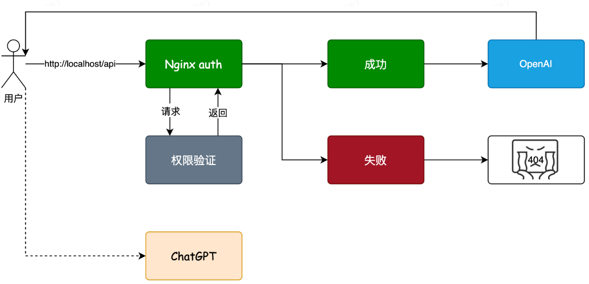

### 二、Shiro登录发放访问token

用户使用 OpenAI 接口，如；http://localhost/api 时，需要根据用户身份标识做一些访问的验证和限定。

要根据用户的账密，先通过登录验证的方式，发放一个 token。

在 SpringBoot 工程中引入进来 Shiro、JWT，进行处理。

整个流程为；以用户访问一个登录接口，服务端使用用户的账号和密码进行验证，验证通过后发放 Token，之后再使用 Token 访问 OpenAI 地址。

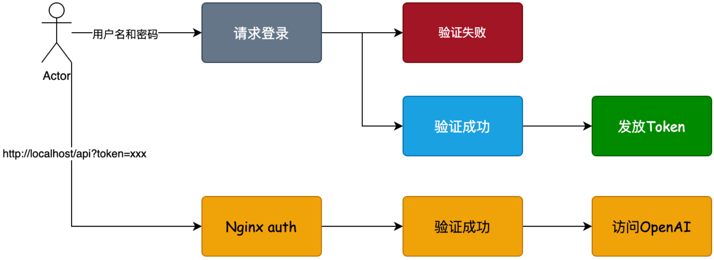

### 三、微信公众号验签和初步对接OpenAI

尝试把OpenAI对接到微信公众号上，实现消息自动回复功能。

整个流程为：对接微信公众号，提供验签服务的get请求和处理消息的post请求以及初始化 chatgpt-sdk-java 服务。当验签完成后接收post请求并做应答处理。

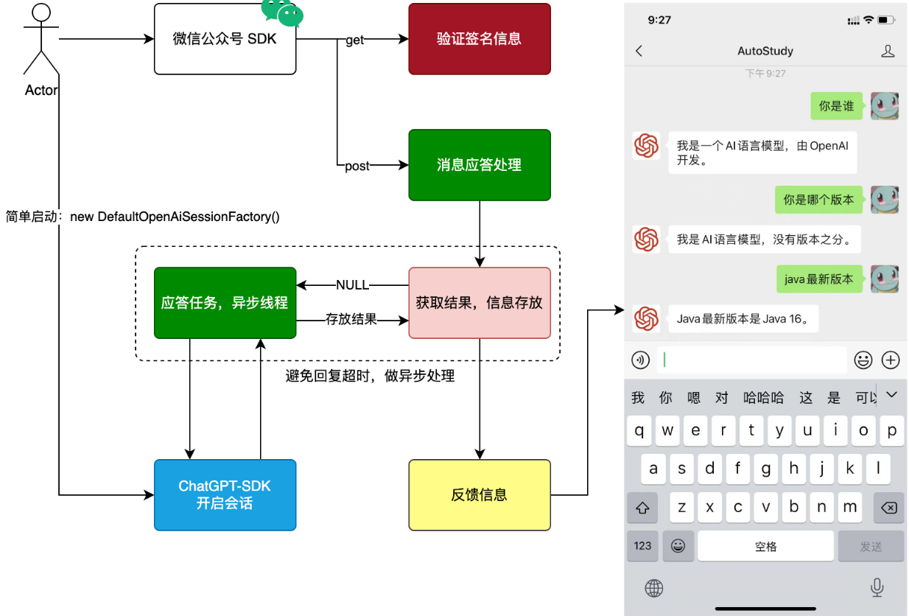

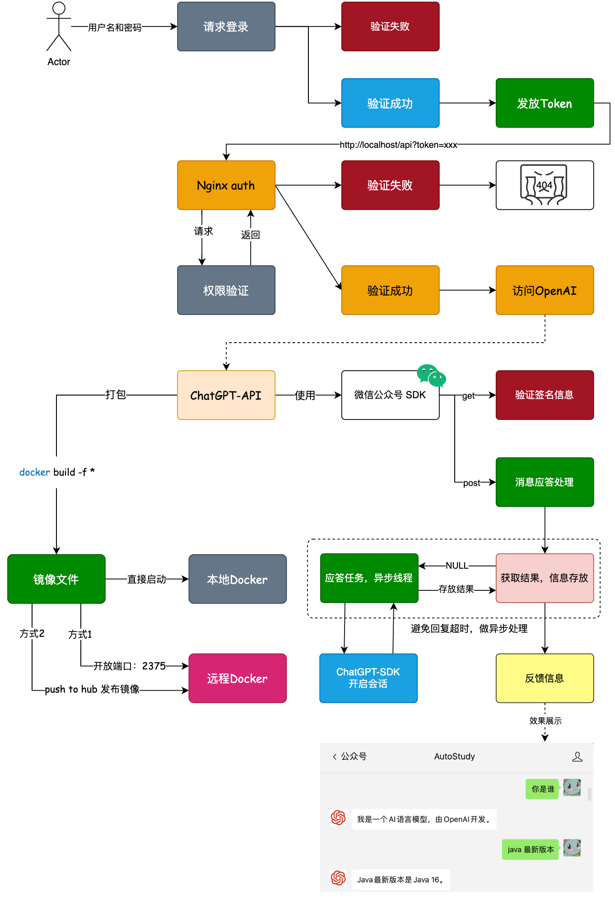

#### 1. 微信公众号

- 注册微信公众号：https://mp.weixin.qq.com/cgi-bin/registermidpage?action=index&lang=zh_CN

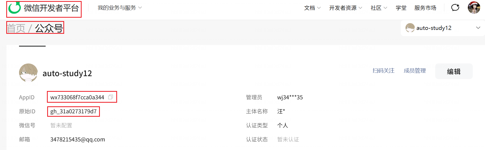

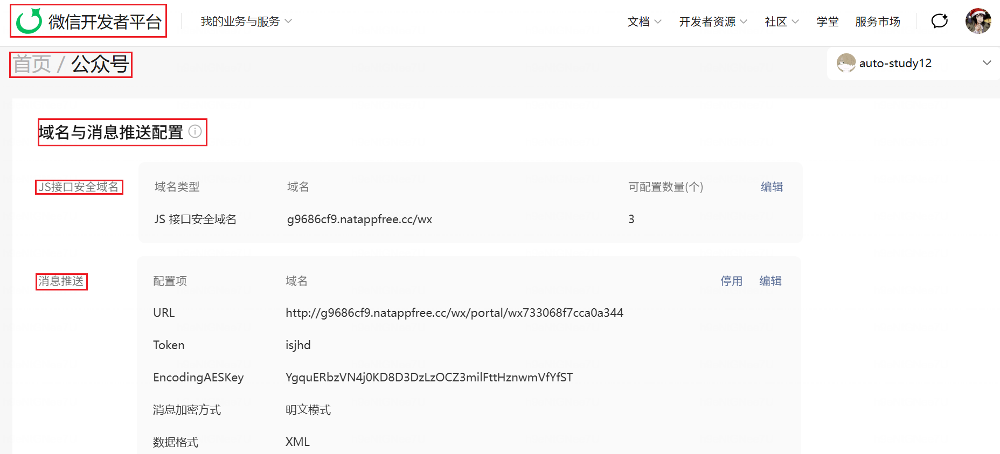

我的公众号：https://developers.weixin.qq.com/console/product/mp/wx733068f7cca0a344?tab1=basicInfo&tab2=dev

- AppID：wx733068f7cca0a344
- 原始ID：gh_31a0273179d7

#### 2. 内网穿透

内网穿透使用：https://natapp.cn/

### 四、工程重构和流式异步响应接口实现

开发一个可以用于后续提供给 ChatGPT-WEB 页面使用的异步响应接口

整个流程为；以DDD工程结构模型，提供 HTTP 响应式接口，调用 OpenAI 应答请求信息。

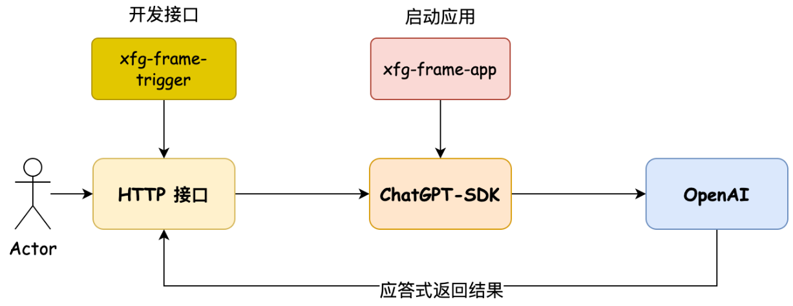

- 整个流程其实简单，复杂点在于怎么提供一个异步响应接口，并怎么把这个需要一堆的调用代码的实现，分配到各个类里去处理。

### 五、公众号发送验证码鉴权登录

登录鉴权，鉴权通过后才允许对 ChatGPT 的使用。

一般一个软件服务，都会包括3大块；登录、支付、服务，只提供服务叫开源、提供服务和登录叫吸粉、三个都提供就商业变现。

公众号分为个人和企业，企业的公众号功能更完整，可以简单的通过用户扫码的方式进行登录，因为扫码的时候可以涵盖请求连接上的信息。但个人公众号是不允许这样的做的。

验证码方式，让用户在公众号回复指定数字，获取一个验证码，此时验证码写入内存/缓存中。并引导用户拿到验证码在网页登录页面输入，输入后由前端页面调用服务端接口校验验证码。此时校验后可以拿到一个 Token 授权使用。

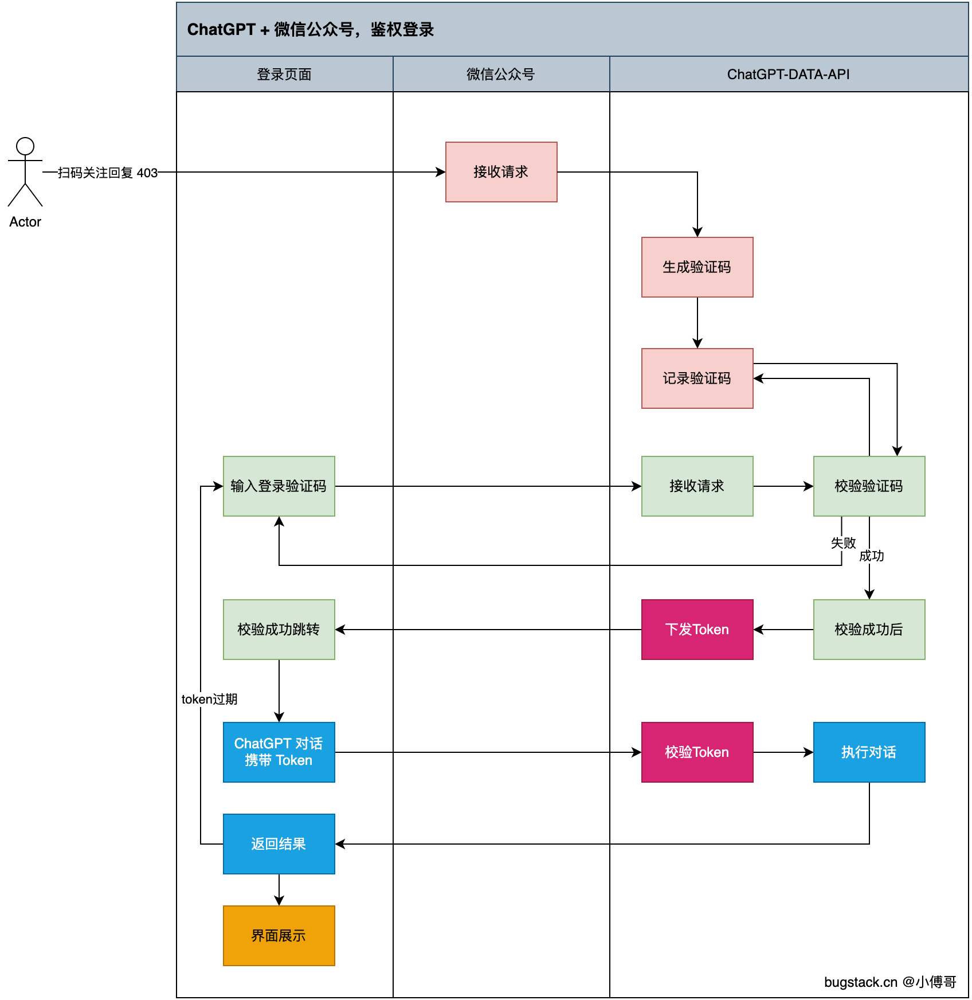

### 六、白名单和敏感词规则过滤

部署服务后，外部的用户调用时是要做频次限制的，此外还要做非常重要的敏感词过滤。

频次、频率、白名单、敏感词等，都是用于支撑核心业务之外辅助流程，这些流程都是比较容易随着业务的变动而发生变化。所以我们要把这类东西设计在核心流程之外，而不能直接把规则的代码与核心业务的代码写在一块。因为区分不出边界的代码，会让工程的腐化程度不断加剧。

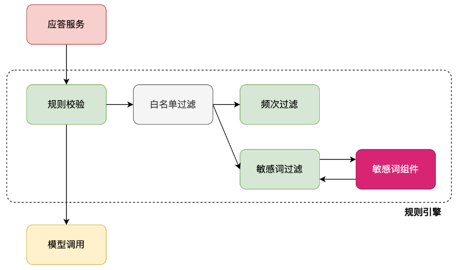

### 七、用户额度账号的校验领域实现

为了产品化，在后续拓展为，每个用户可以支付购买自己的额度并使用，那么则需要创建出用户账户、商品、订单和支付服务。

为了实现这一整条链路功能，我们先来做一个账户的使用，后续在陆续添加其他功能。

在 openai 领域中，我们设计了规则和工厂🏭的组合使用，而所有的这些频繁变化的行为都可以被抽象为规则。那么这里正好可以把账户的属性用规则的方式进行过滤处理，包括；账户状态、可用模型、账户额度。

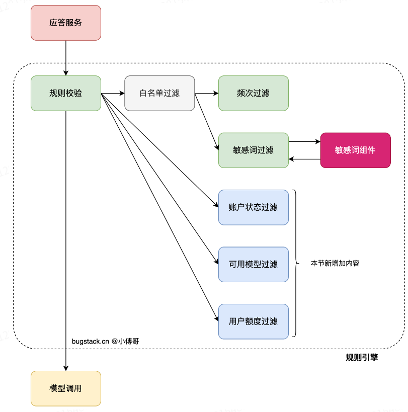

### 八、商品下单对接微信支付

为用户账户额度充值，设计商品和订单服务。并对接微信支付，通过下单扫码支付的方式完成自动化充值服务。

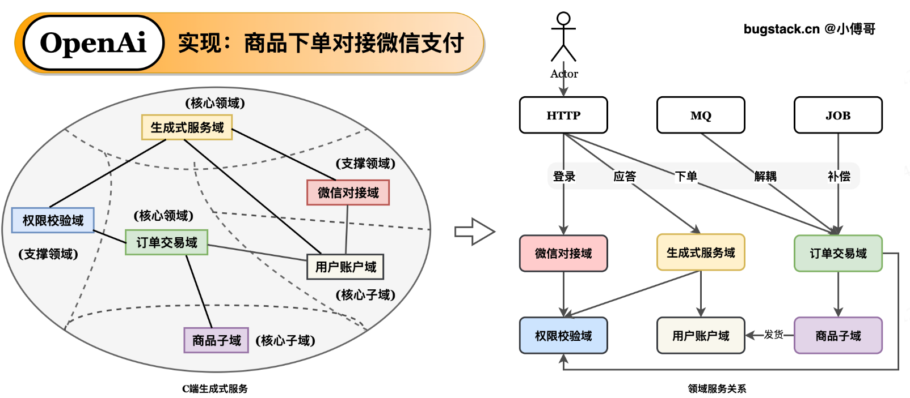

- 左侧，是整个项目所涉及的领域服务，包括；生成式服务、权限校验、微信支付、用户账户、订单交易、商品。构成整个服务功能。
- 右侧，以用户视角下，了解各个领域的上下文关系。从微信对接、权限校验、再到生成式服务和账户域使用。以及本节要实现的订单交易域。

做业务功能开发，我们可以先只思考核心的主流程。那么本节要做的功能，最核心的就是用户选择商品下单，之后生成一个支付URL，用户扫码支付。再接收到支付成功回调后，把用户购买的订单发货【额度充值】。

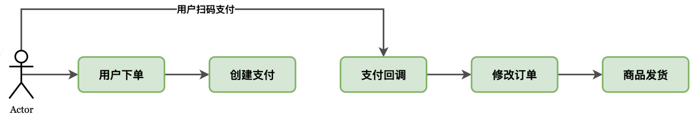

这是一个非常核心的主流程。有了主流程，我们在思考下可能出现的异常流程。如；

1. 用户订单创建成功，但创建支付单 HTTP 超时失败。
2. 支付回调时，系统宕机或者本身服务出问题。
3. 支付成功后发送MQ消息，消息丢失，用户支付掉单。
4. 长时间未支付，超时订单。

那么，这些就都是可能出现的异常流程。虽然概率很低，但随着使用规模的增加，很低概率的问题，也会产生较大规模的客诉问题。所以要针对这些流程做补偿处理。

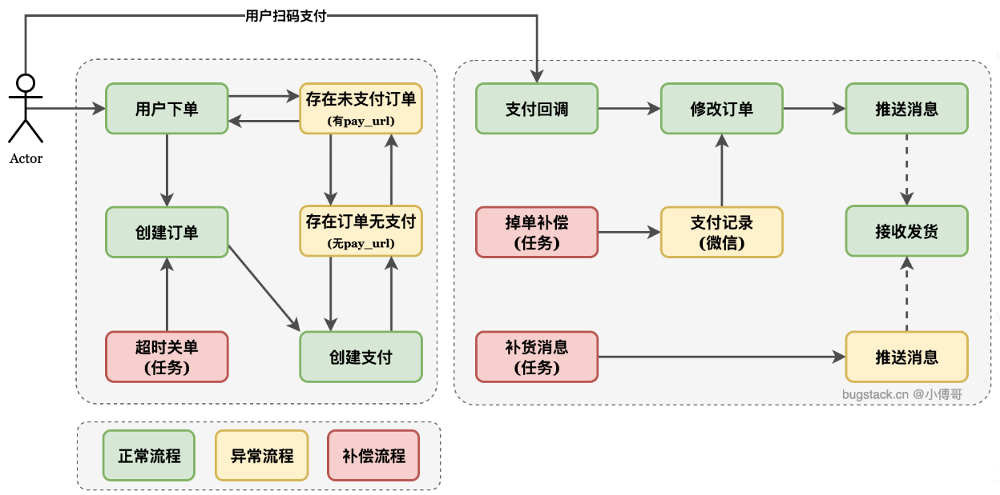

- 针对1~4提到异常流程，一条支付链路就会被扩展为现在的样子，在各个流程中需要穿插进入异常补偿流程。
- 用户下单，但可能存在之前下的残单，那么就要对应给予补充的流程后，再返回回去。
- 支付回调，仍然可能有异常。所以要有掉单补偿和发货补偿。两条任务处理。

#### 1. 对接支付宝沙箱

支付宝沙箱地址：https://open.alipay.com/develop/sandbox/app

### 九、OpenAi多渠道策略模式

现有的工程实现中，已经对接了 ChatGPT 大模型通信渠道，那么本节将使用策略模式扩展新的渠道。

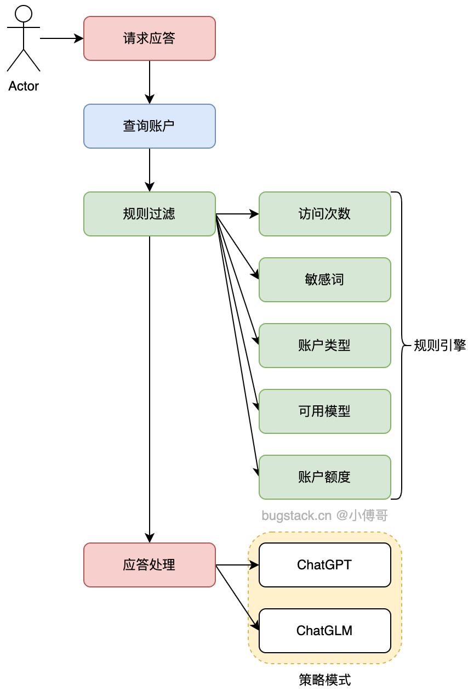

### 十、应用分布式设计

当前的 OpenAi(ChatGPT、ChatGLM)项目，需要用户登录鉴权，才能登录使用服务。

但对于验证码的保存是使用的 Guava 内存存储，需要分布式部署。

将原有的 Guava 用于验证码存储和校验的地方，替换为 Redis 服务。

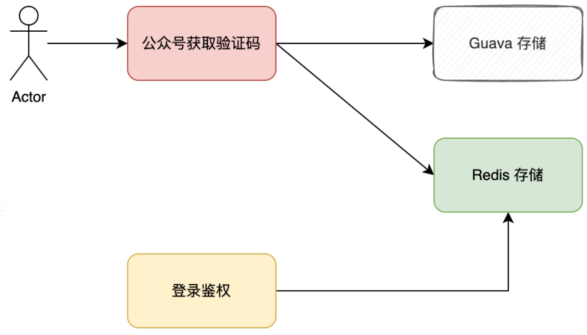

## chatgpt-sdk

### 一、ChatGPT-SDK组件工程简单功能实现

搭建一个 ChatGPT-SDK 组件工程，专门用于封装对 OpenAI 接口的使用。

由于 OpenAI 接口本身较多，并有各类配置的设置，所以开发一个共用的 SDK 组件，更合适我们在各类工程中扩展使用。

整个流程为：以会话模型为出口，驱动整个服务的调用链路。并对外提供会话工厂的创建和使用。

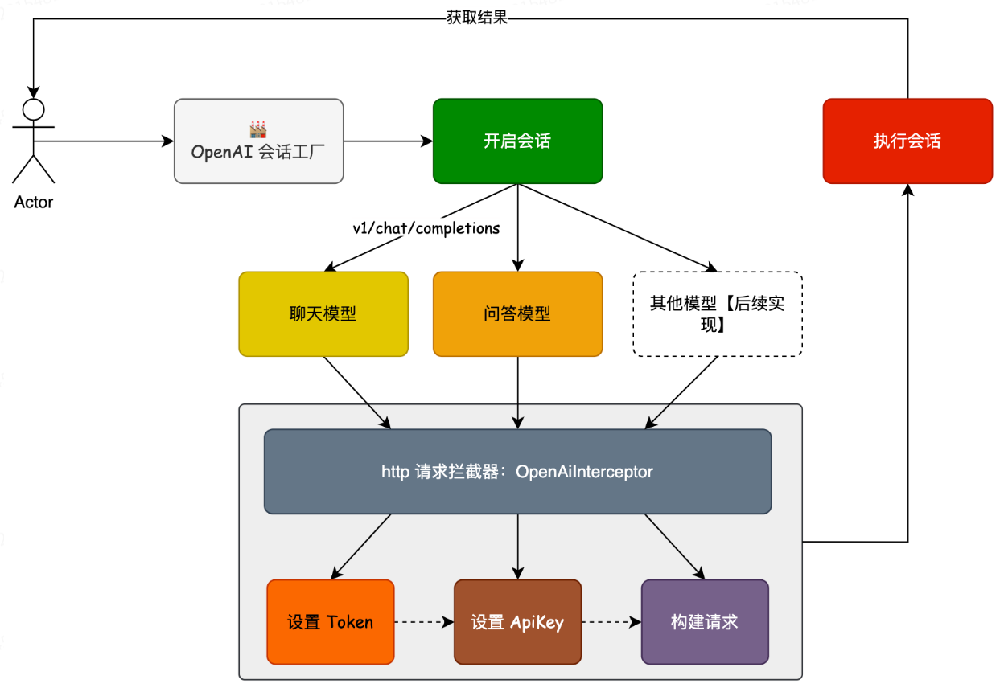

- 我们通过工厂模型，开启一个使用 okhttp3 封装的 OpenAI 会话服务，进行流程的调用。同时这里还包括请求拦截的处理，因为我们需要对http请求设置一些必要的参数信息，如；ApiKey、Token 等。
- 这里还需要用到 Retrofit2 组件，Retrofit2 可以将 HTTP API 转化为 Java 接口，并通过注解的方式描述请求参数和响应结果等信息，从而方便地发送网络请求。具体可以的代码对 IOpenAiApi 的赋值实现。

#### 1. 对接GLM

- 文档：https://open.bigmodel.cn/dev/api/
- ApiKey：https://open.bigmodel.cn/usercenter/apikeys

c545b5a1d03042f9872b22a22f29b6a3.PwbHQ55ASCn3Ickn

#### 2. 对接Openai

- 代理地址：https://api1.openai-proxy.com/

### 二、流式应答会话设计实现

以 IOpenAiApi 统一接口、OpenAiSession 统一会话，2个标准下。封装流式应答操作，流式应答操作以事件实现方式接收应答消息。

那么这样的实现，就可以在统一的会话工厂中获得会话接口服务以后，根据接口入参的不同做不同的请求处理。

整个流程为：丰富 OpenAiSession 会话服务接口，增加流式回答的事件监听处理。此过程的实现以 MyBatis 的会话模型为参照。

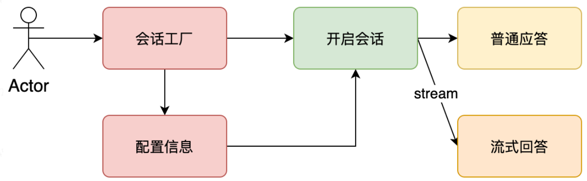

- 一个需求的实现分为三个部分；架构、设计、代码。架构是骨架、设计方法、代码是填材料。如果没有设计方法的设计模式运用，就相当于把代码的材料，直接扔到架构里。久而久之代码也就越来越混乱了。
- 所以本章的重点不只是功能的实现，还包括了如何在会话这个流程下，把流式的事件应答处理，巧妙的封装到同一的会话接口内。

### 三、完善实现各类常用接口

官网除了提供问答接口，其实还有很多接口内容，比如说通过一段文字描述就可以绘制出图片的操作。

整个流程为；按照整体的会话模型设计，封装本章所提诉求的接口内容。

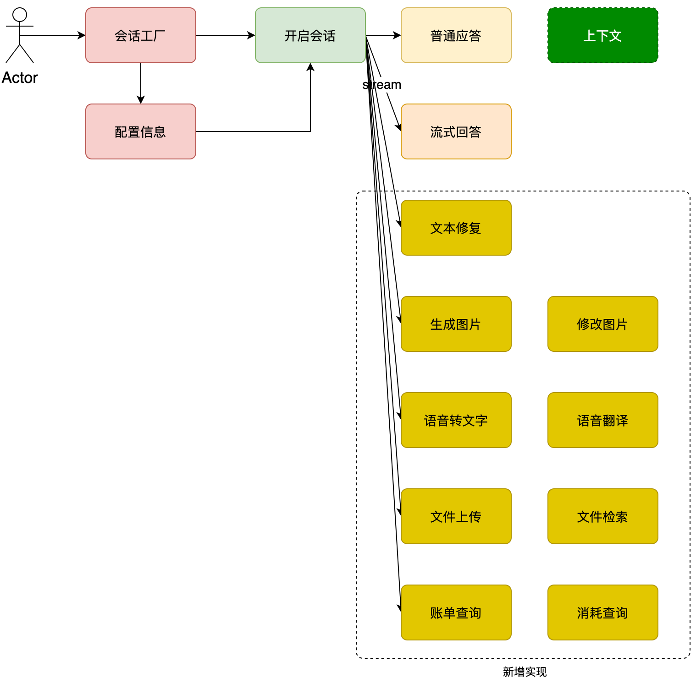

- 本章的实现会基于官网的HTTP接口进行封装处理，官网中对各个例子都有调用的入参和出参，非常清晰。后续也可以结合官网内容做更新和扩展。例如：微调相关的接口也可以先自行扩展。
- 只要大家把这样一套接口封装的 SDK 做下来，以后你再封装其他各类 API 都有自己的设计思路和落地经验了。

### 四、支持多渠道对话

原本在 ChatGPT SDK 中，我们想调用一个 ChatGPT 的接口，是在 SDK 初始化阶段设置 ApiKey、ApiHost，那么所有的访问用户都会调用到这一套的 ApiKey、ApiHost 上来。但对于一些特殊场景，需要给每个用户分配不同的 ApiKey 甚至可能还有对应的 ApiHost 时，目前的 SDK 就不好扩展了。所以我们要完善这块的功能，让 ChatGPT SDK 支持不同的渠道对话。

整个流程为：扩展会话入参信息，在 HTTP 客户端中支持动态参数处理；

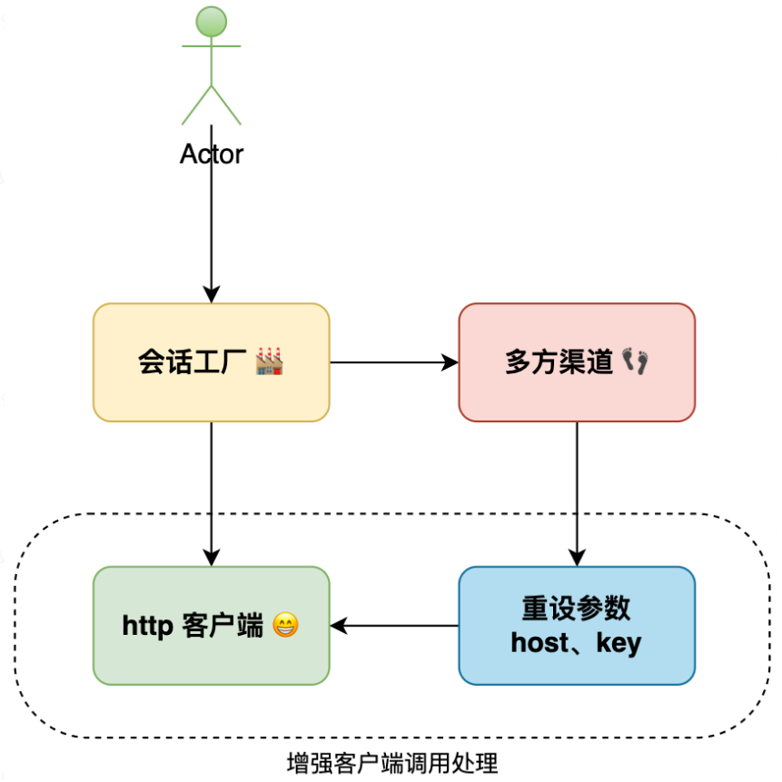

- 小傅哥会在原有的 SDK 中增加对参数的透传处理，重点涉及对 OpenAiInterceptor 的改造。相当于你要动态的处理 ApiKey 的参数传递。另外 ApiHost 是已经动态的拼接到 URL 重新组合了。
- 那么现在的 DefaultOpenAiSession#chatCompletions 接口，就有了动态使用 ApiHost、ApiKey 的能力。

