# GrandMarketing1.0

## 一、项目初始化

### 1. 下载脚手架

- 脚手架(轻量版)：https://gitcode.net/KnowledgePlanet/road-map/xfg-frame-archetype-lite
- 脚手架(标准版)：https://gitcode.net/KnowledgePlanet/road-map/xfg-frame-archetype-std

> 举例：git clone https://gitcode.net/KnowledgePlanet/road-map/xfg-frame-archetype-lite.git


### 2. 脚手架导入Maven

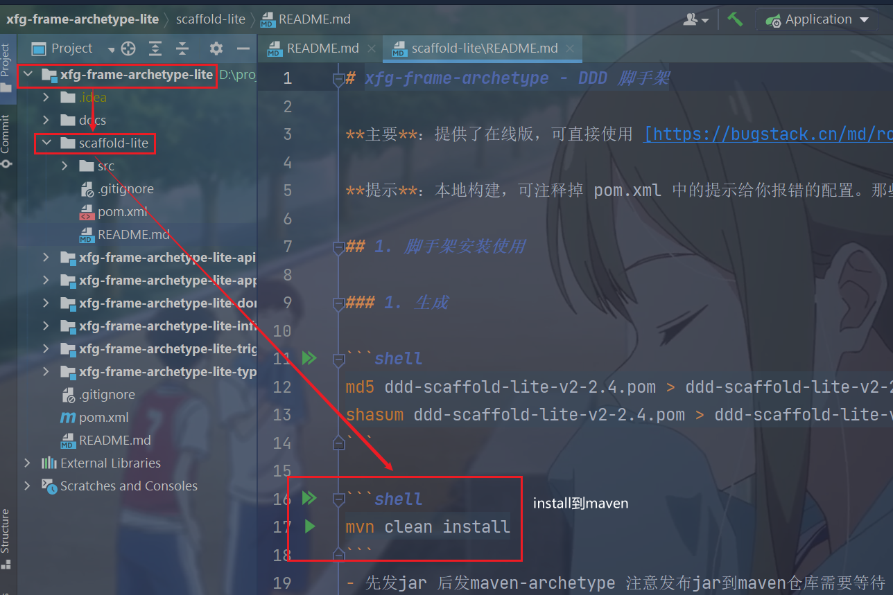


### 3. 使用脚手架创建项目

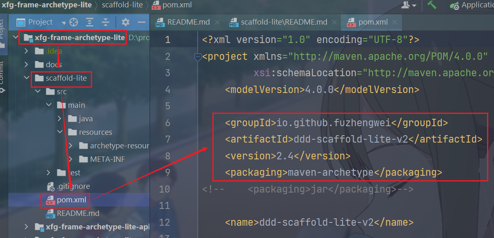

脚手架的名字，创建项目需要用到

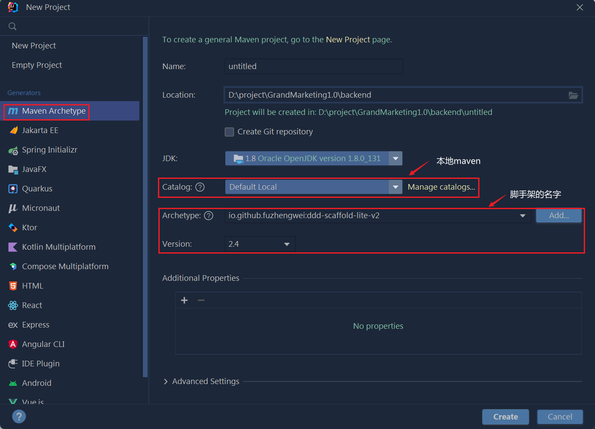


结果

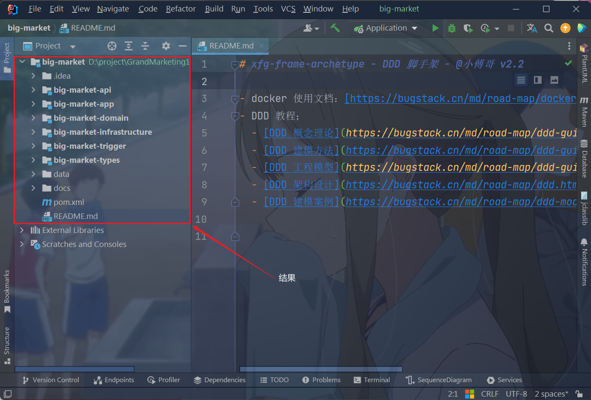


### 4. 环境配置

#### 4.1 mysql

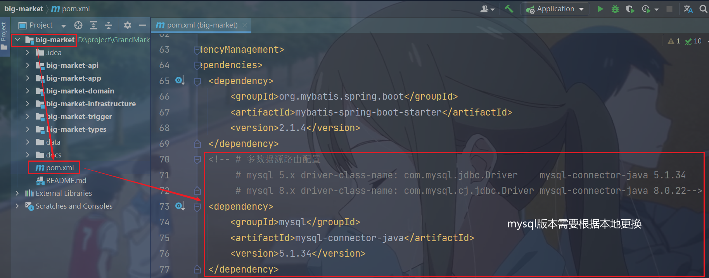

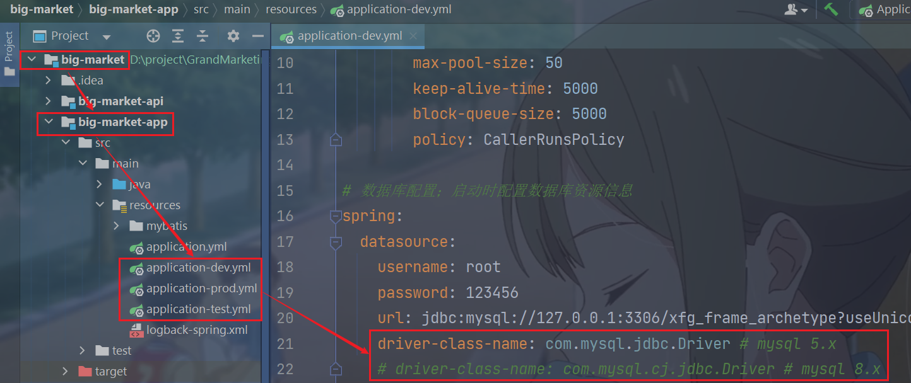


### 5. 代码上传

创建一个空项目到代码托管平台

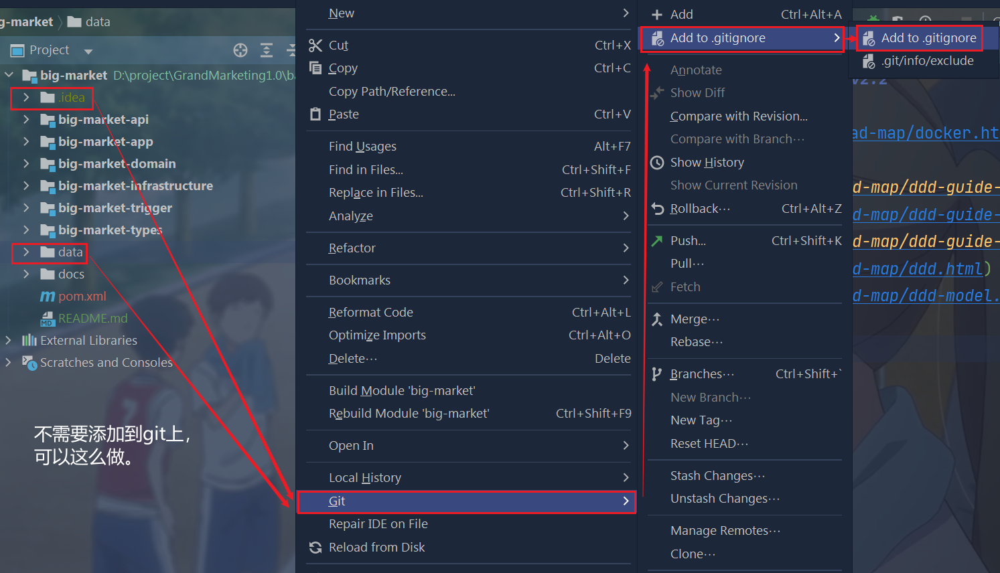

然后add -> commit -> push


## 二、营销服务

### 1. 抽奖策略和库表设计

通过分析大营销平台中抽奖的产品功能，设计抽奖策略模型和库表结构。抽奖策略是抽奖中非常核心功能，尤其是本课程中所体现出的抽奖产品功能，需要更好的库表结构支撑着领域模型的实现。

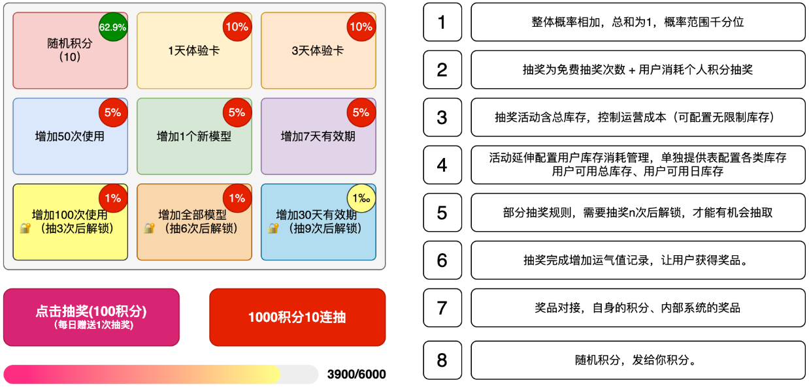

- 首先，抽奖如果不添加各项手段的情况下，单一玩法的可操作性是比较低的。所以这里添加了；随机积分、运气值、抽奖解锁的相关功能。


### 2. 分支操作

#### 2.1 拉取分支

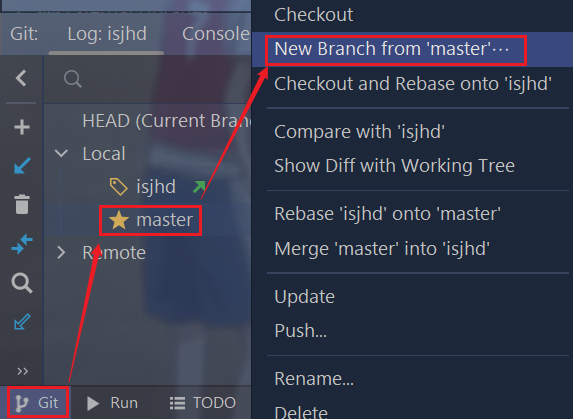

一节课程拉一个新的分支，你在学习的时候，最好也拉一个分支。这样即使写错了，还可以回滚。


#### 2.2 提交代码

add -> commit，不提交到远程库


#### 2.3 合并分支

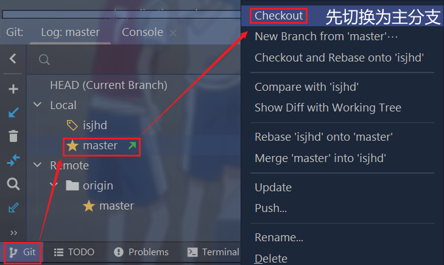

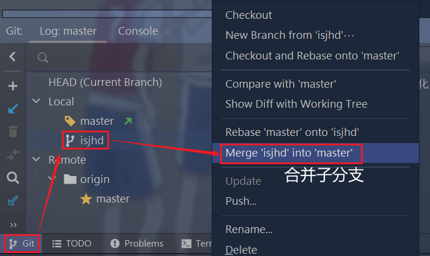

当你开发完成代码后，把代码合并到主 master，在通过在主 master 分支，push代码。


### 3. 创建库表

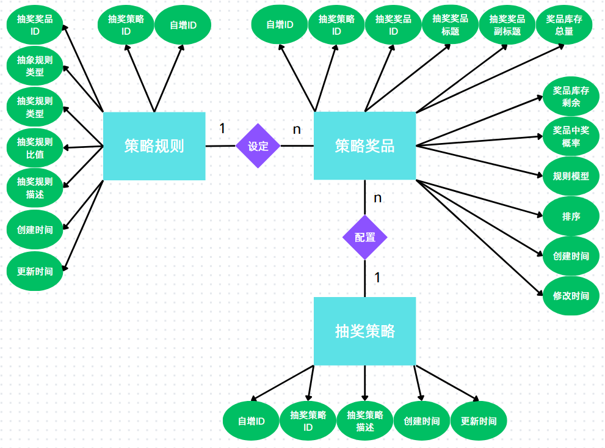

#### 3.1 策略总表

```sql
CREATE TABLE `strategy` (
  `id` bigint(11) unsigned NOT NULL AUTO_INCREMENT COMMENT '自增ID',
  `strategy_id` bigint(8) NOT NULL COMMENT '抽奖策略ID',
  `strategy_desc` varchar(128) NOT NULL COMMENT '抽奖策略描述',
  `create_time` datetime NOT NULL DEFAULT CURRENT_TIMESTAMP COMMENT '创建时间',
  `update_time` datetime NOT NULL DEFAULT CURRENT_TIMESTAMP ON UPDATE CURRENT_TIMESTAMP COMMENT '更新时间',
  PRIMARY KEY (`id`),
  KEY `idx_strategy_id` (`strategy_id`)
) ENGINE=InnoDB DEFAULT CHARSET=utf8mb4;

LOCK TABLES `strategy` WRITE;

INSERT INTO `strategy` (`id`, `strategy_id`, `strategy_desc`, `create_time`, `update_time`)
VALUES (1,100001,'抽奖策略','2023-12-09 09:37:19','2023-12-09 09:37:19');
```


#### 3.2 策略奖品

```sql
CREATE TABLE `strategy_award` (
  `id` bigint(11) unsigned NOT NULL AUTO_INCREMENT COMMENT '自增ID',
  `strategy_id` bigint(8) NOT NULL COMMENT '抽奖策略ID',
  `award_id` int(8) NOT NULL COMMENT '抽奖奖品ID - 内部流转使用',
  `award_title` varchar(128) NOT NULL COMMENT '抽奖奖品标题',
  `award_subtitle` varchar(128) DEFAULT NULL COMMENT '抽奖奖品副标题',
  `award_count` int(8) NOT NULL DEFAULT '0' COMMENT '奖品库存总量',
  `award_count_surplus` int(8) NOT NULL DEFAULT '0' COMMENT '奖品库存剩余',
  `award_rate` decimal(6,4) NOT NULL COMMENT '奖品中奖概率',
  `rule_models` varchar(256) DEFAULT NULL COMMENT '规则模型，rule配置的模型同步到此表，便于使用',
  `sort` int(2) NOT NULL DEFAULT '0' COMMENT '排序',
  `create_time` datetime NOT NULL DEFAULT CURRENT_TIMESTAMP COMMENT '创建时间',
  `update_time` datetime NOT NULL DEFAULT CURRENT_TIMESTAMP ON UPDATE CURRENT_TIMESTAMP COMMENT '修改时间',
  PRIMARY KEY (`id`),
  KEY `idx_strategy_id_award_id` (`strategy_id`,`award_id`)
) ENGINE=InnoDB DEFAULT CHARSET=utf8mb4;

LOCK TABLES `strategy_award` WRITE;

INSERT INTO `strategy_award` (`id`, `strategy_id`, `award_id`, `award_title`, `award_subtitle`, `award_count`, `award_count_surplus`, `award_rate`, `rule_models`, `sort`, `create_time`, `update_time`)
VALUES
(1,100001,101,'随机积分',NULL,80000,80000,80.0000,'rule_random,rule_luck_award',1,'2023-12-09 09:38:31','2023-12-09 10:58:06'),
	(2,100001,102,'5次使用',NULL,10000,10000,10.0000,'rule_luck_award',2,'2023-12-09 09:39:18','2023-12-09 10:34:23'),
	(3,100001,103,'10次使用',NULL,5000,5000,5.0000,'rule_luck_award',3,'2023-12-09 09:42:36','2023-12-09 10:34:24'),
	(4,100001,104,'20次使用',NULL,4000,4000,4.0000,'rule_luck_award',4,'2023-12-09 09:43:15','2023-12-09 10:34:25'),
	(5,100001,105,'增加gpt-4对话模型',NULL,600,600,0.6000,'rule_luck_award',5,'2023-12-09 09:43:47','2023-12-09 10:34:26'),
	(6,100001,106,'增加dall-e-2画图模型',NULL,200,200,0.2000,'rule_luck_award',6,'2023-12-09 09:44:20','2023-12-09 10:34:26'),
	(7,100001,107,'增加dall-e-3画图模型','抽奖1次后解锁',200,200,0.2000,'rule_lock,rule_luck_award',7,'2023-12-09 09:45:38','2023-12-09 10:30:59'),
	(8,100001,108,'增加100次使用','抽奖2次后解锁',199,199,0.1999,'rule_lock,rule_luck_award',8,'2023-12-09 09:46:02','2023-12-09 12:20:52'),
	(9,100001,109,'解锁全部模型','抽奖6次后解锁',1,1,0.0001,'rule_lock,rule_luck_award',9,'2023-12-09 09:46:39','2023-12-09 12:20:50');
```


#### 3.3 策略规则

```sql
CREATE TABLE `strategy_rule` (
  `id` bigint(11) unsigned NOT NULL AUTO_INCREMENT COMMENT '自增ID',
  `strategy_id` int(8) NOT NULL COMMENT '抽奖策略ID',
  `award_id` int(8) DEFAULT NULL COMMENT '抽奖奖品ID【规则类型为策略，则不需要奖品ID】',
  `rule_type` tinyint(1) NOT NULL DEFAULT '0' COMMENT '抽象规则类型；1-策略规则、2-奖品规则',
  `rule_model` varchar(16) NOT NULL COMMENT '抽奖规则类型【rule_random - 随机值计算、rule_lock - 抽奖几次后解锁、rule_luck_award - 幸运奖(兜底奖品)】',
  `rule_value` varchar(64) NOT NULL COMMENT '抽奖规则比值',
  `rule_desc` varchar(128) NOT NULL COMMENT '抽奖规则描述',
  `create_time` datetime NOT NULL DEFAULT CURRENT_TIMESTAMP COMMENT '创建时间',
  `update_time` datetime NOT NULL DEFAULT CURRENT_TIMESTAMP ON UPDATE CURRENT_TIMESTAMP COMMENT '更新时间',
  PRIMARY KEY (`id`),
  KEY `idx_strategy_id_award_id` (`strategy_id`,`award_id`)
) ENGINE=InnoDB DEFAULT CHARSET=utf8mb4;

LOCK TABLES `strategy_rule` WRITE;

INSERT INTO `strategy_rule` (`id`, `strategy_id`, `award_id`, `rule_type`, `rule_model`, `rule_value`, `rule_desc`, `create_time`, `update_time`)
VALUES
(1,100001,101,2,'rule_random','1,1000','随机积分策略','2023-12-09 10:05:30','2023-12-09 12:55:52'),
	(2,100001,107,2,'rule_lock','1','抽奖1次后解锁','2023-12-09 10:16:41','2023-12-09 12:55:53'),
	(3,100001,108,2,'rule_lock','2','抽奖2次后解锁','2023-12-09 10:17:43','2023-12-09 12:55:54'),
	(4,100001,109,2,'rule_lock','6','抽奖6次后解锁','2023-12-09 10:17:43','2023-12-09 12:55:54'),
	(5,100001,107,2,'rule_luck_award','1,100','兜底奖品100以内随机积分','2023-12-09 10:30:12','2023-12-09 12:55:55'),
	(6,100001,108,2,'rule_luck_award','1,100','兜底奖品100以内随机积分','2023-12-09 10:30:43','2023-12-09 12:55:56'),
	(7,100001,101,2,'rule_luck_award','1,10','兜底奖品10以内随机积分','2023-12-09 10:30:43','2023-12-09 12:55:57'),
	(8,100001,102,2,'rule_luck_award','1,20','兜底奖品20以内随机积分','2023-12-09 10:30:43','2023-12-09 12:55:57'),
	(9,100001,103,2,'rule_luck_award','1,30','兜底奖品30以内随机积分','2023-12-09 10:30:43','2023-12-09 12:55:58'),
	(10,100001,104,2,'rule_luck_award','1,40','兜底奖品40以内随机积分','2023-12-09 10:30:43','2023-12-09 12:55:59'),
	(11,100001,105,2,'rule_luck_award','1,50','兜底奖品50以内随机积分','2023-12-09 10:30:43','2023-12-09 12:56:00'),
	(12,100001,106,2,'rule_luck_award','1,60','兜底奖品60以内随机积分','2023-12-09 10:30:43','2023-12-09 12:56:00'),
	(13,100001,NULL,1,'rule_weight','6000,102,103,104,105,106,107,108,109','消耗6000分，必中奖范围','2023-12-09 10:30:43','2023-12-09 12:58:21'),
	(14,100001,NULL,1,'rule_blacklist','1','黑名单抽奖，积分兜底','2023-12-09 12:59:45','2023-12-09 13:42:23');
```


### 4. 基础层持久化数据

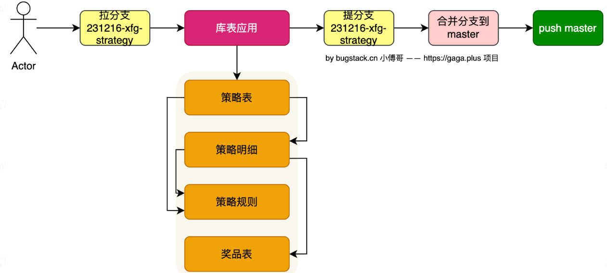


### 5. 策略概率装配处理

> 抽奖的算法一种是空间换时间，另外一种是时间换空间。映射到方案上，空间换时间，是提前计算好抽奖概率分布，用本地内存 guava 或者 redis 存储，最后抽奖的时候通过生成的随机值，在空间内定位即可，复杂度为O(1)。


持久层负责对数据库和redis进行连接

数据库层面：查询所有对应id的strategyAward的集合

比如说：

| id   | 概率 |
| ---- | ---- |
| 1001 | 0.50 |
| 1001 | 0.25 |
| 1001 | 0.25 |

然后向redis塞入key=id，value=集合


业务层负责实现抽奖

1. 先查到对应集合
2. 获取最小概率值
3. 获取概率值总和
4. 用概率值总和 除以 最小概率值，如 1 / 0.0001 就能得到10000。
5. 然后就能获取到每个奖品对应的概率范围，一个个存放到集合。
6. 打乱顺序。
7. 然后生成键值对对应关系。
8. 存到redis中，存入key=id，value=总数。并且存储概率查找表(时间负责度O(1))


测试

```java
@Slf4j
@RunWith(SpringRunner.class)
@SpringBootTest
public class StrategyArmoryTest {

    @Resource
    private IStrategyArmory strategyArmory;

    //把数据库内容加载到缓存
    @Test
    public void test_strategyArmory() {
        strategyArmory.assembleLotteryStrategy(100002L);
    }

    //通过传入id，获得随机值。
    @Test
    public void test_getAssembleRandomVal() {
        log.info("测试结果：{} - 奖品ID值", strategyArmory.getRandomAwardId(100002L));
        log.info("测试结果：{} - 奖品ID值", strategyArmory.getRandomAwardId(100002L));
        log.info("测试结果：{} - 奖品ID值", strategyArmory.getRandomAwardId(100002L));
    }

}
```


### 6. 策略权重概率装配

在大营销平台的抽奖子模块中，需要满足用户抽奖N积分后，可中奖范围的设定。也就是说你总共消耗了6000积分抽奖了，那么接下来的抽奖就会有圈定到固定的奖品范围，不会让用户再抽到过低价值的奖品。那么这就需要我们在设计系统实现的时候，处理下不同策略规则权重的概率装配。

1. 先通过前端传来是哪个策略，如：10001L，10002L
2. 然后从数据库根据这个策略找到对应的奖品集合，并加入缓存
3. 根据奖品集合构建对应的奖品概率，并一个个插入键值对中，时间复杂度为O(1)
4. 然后找到对应的权重策略模型，根据这个找到策略规则
5. 根据策略规则里面的，构建消耗不同积分对应可抽奖品数量，并建立对应的集合存入缓存中
6. 最后只要根据前端传来的是哪个抽奖策略和策略规则，即可限定抽奖范围。


### 7. 抽奖前置规则过滤

在我们的流程设计中，用户执行抽奖时会判断是否已经超过N积分，如果超过N积分则可以在限定范围内进行抽奖。同时如果用户是黑名单范围的羊毛党用户，则只返回固定的奖品ID。

这一章节的实现中则会涉及到工厂和策略定义出来的规则模型，并满足后续的规则扩展。再通模板模式定义出抽奖的基本过程，来使用抽奖规则。


**流程设计**

在流程实现中，我们需要按照规则和抽奖，两个部分的功能进行边界拆分。这样可以满足后续功能的扩展添加，不至于影响全部流程的。

- 整个规则来说，分为抽奖前、抽奖中、抽奖后，三个阶段执行。本节我们先来处理抽奖前的规则。
- 在工程分包上，需要添加 rule 来处理抽奖规则，在添加 raffle 处理抽奖过程。


**工作流程**

1. 首先，初始化时，spring容器会将过滤器，由工厂置入一个集合中。
2. 然后直接调用一个接口，就能找到对应的实现类，在实现类里面，先进行参数校验。然后通过参数找到对应策略，通过策略进行规则过滤，规则过滤由子类具体实现。
3. 规则过滤中，先从工厂里面找到过滤器集合，先找里面是否包含黑名单，如果有，进入到黑名单过滤器里面，查询是否属于黑名单用户，不是的话，继续向下走。
4. 然后再匹配其他过滤规则，如果匹配上了，就按照指定规则，如果没有匹配上，按照默认规则。


### 8. 抽奖中置规则过滤

怎么能刺激用户更多的消耗手里的积分。频次更高的参与抽奖。这个时候产品就会从抽奖的行为上下手。

比如：一个用户最开始前三次抽奖，能抽奖的范围为1-6个奖品，当抽奖3次后解锁1-7、抽奖6次后解锁1-9这样一个处理。

那么用户已经抽奖一次，就会想着在抽奖下好增加抽奖奖品的范围。从而更多的消耗用户积分。

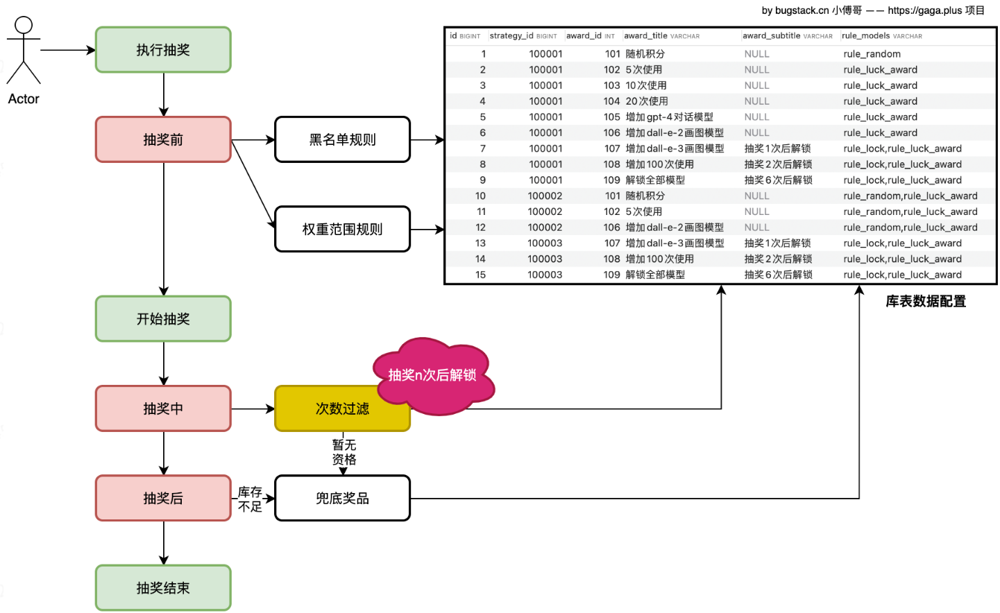


**流程步骤**

1. 先校验参数 用户ID 和 策略ID 是否存在
2. 根据策略ID查询对应策略
3. 前置查询
4. 根据策略ID查询得到随机的奖品ID
5. 根据奖品ID和策略ID得到对应规则模型
6. 开始中置查询，根据规则模型找到对应的过滤类
7. 过滤类根据是否达到解锁条件来决定返回什么


### 9. 责任链模式处理抽奖规则

因为前置规则的校验含带了抽奖的行为处理，这样绑定到规则流程实现中会显得有些臃肿，让规则负责的事情变得更多。

所以使用责任链模式进行优化完善，让整个代码流程变得更加清晰。

抽奖的前置规则在抽奖中是一个什么行为。其实它可以被抽象为一种策略行为，比如；黑名单抽奖策略、权重抽奖策略、白名单抽奖策略等。

而这些策略规则是一种互斥行为，比如走了黑名单规则，就不应该在继续走权重规则了。那么对于这样的情况，责任链的设计就更加合适了。

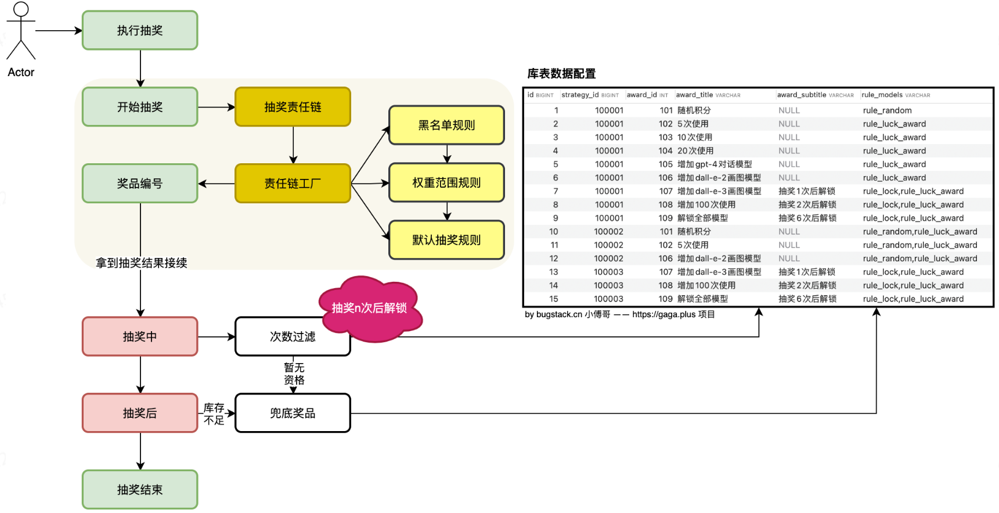


**流程步骤**

1. 主要是改变抽奖前的方式，改成责任链模式。
2. 将黑名单、权重、白名单等策略类联合成一个链表，如果是这个策略则直接返回，如果不是，则跳转到下一个链表节点，直到最后返回默认策略。
3. 最后再通过一个工厂类获得这个链表。


### 10. 抽奖规则树模型结构设计

引入新的设计模式结构，解决现阶段中抽奖策略规则的中、后两部分执行问题。

这里有一个矛盾点需要解决。对于抽奖策略的前置规则过滤是顺序一条链的，有一个成功就可以返回。比如；黑名单抽奖、权重人群抽奖、默认抽奖，总之它只能有一种情况，所以这样的流程是适合责任链的。

那么对于抽奖中到抽奖后的规则，它是一个非多分支情况的规则过滤。

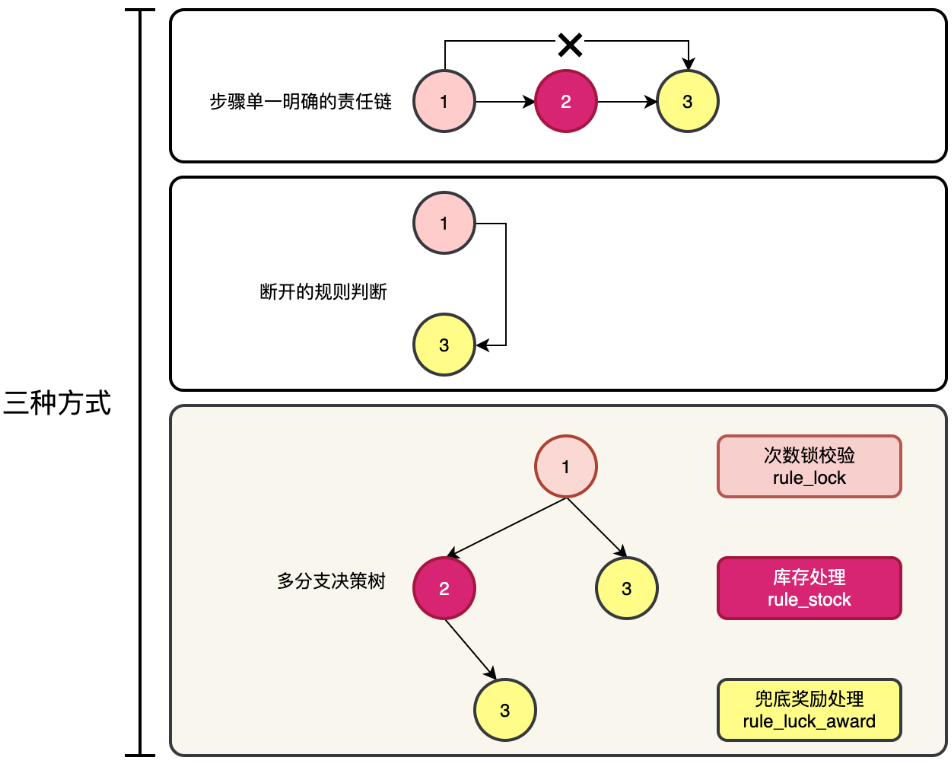


### 11. 模板模式串联抽奖规则

把上一节中规则树的结构设计，整合到抽奖过程中。这样整个抽奖策略过程会包括；责任链进行抽奖计算，基于抽奖计算结果对基础抽奖在进行规则树的过滤，最终返回抽奖结果。

注意：上一节是做了抽奖规则树的领域模型设计，基于这部分内容的实现本节需要把规则树和数据库关联起来

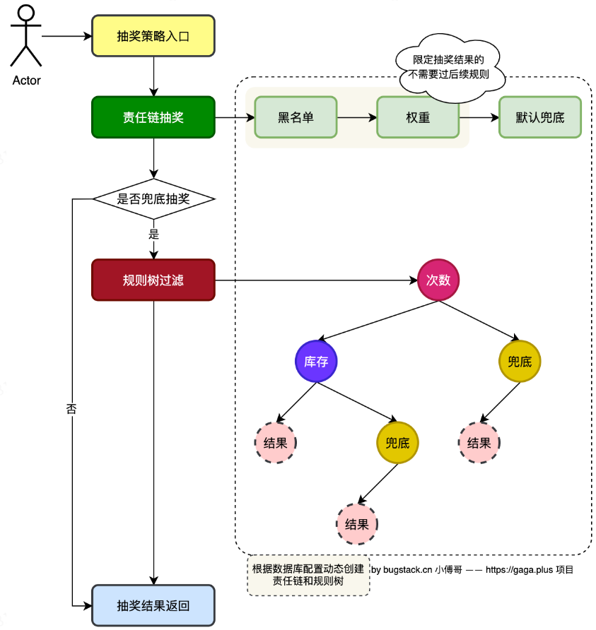


### 12. 不超卖库存规则实现

当通过抽奖策略计算完用户可获得的奖品ID后，接下来就需要对这一条奖品记录进行**库存**的扣减操作。只有奖品库存扣减成功，才可以获得奖品ID对应的奖品，否则将走到兜底奖品。

对于这样的秒杀场景，我们一般都是使用 redis 缓存来处理库存，它只要不超卖就可以。

但也确保一点，不要用一条key加锁和等待释放的方式来处理，这样的效率依然是很低的。所以我们要尽可能的考虑分摊竞争，达到无锁化才是分布式架构设计的核心。


原理

- redis中，decr 命令，将存储在键（key）中的数字值减一，是原子性的。
- redis中，setnx 命令，只有当指定的键不存在时，才会设置键的值。


### 13. 抽奖API接口实现

在大营销的系统架构设计中，有一个 trigger 模块，专门用于提供触发操作。这里我们把 HTTP 调用、RPC（Dubbo）调用、定时任务、MQ监听等动作，都称为触发操作。触发表示通过一种调用方式，调用到领域的服务上。

为了让 HTTP 接口、RPC 接口，都能在一个标准下开发，所以本节会增加一个 big-market-api 模块，定义出接口信息和出入参对象。

以便于分别可以实现本节所需的 HTTP 接口和后续所需的 RPC 接口。


# GrandMarketing2.0

## 一、需求文档

### 1. 抽奖活动场景需求设计

#### 1.1 产品需求

在抽奖中增加每天进入，免费赠送N次抽奖。N次免费后，则引导用户使用积分兑换抽奖。

我们在这一期实现中，只提供免费抽奖。

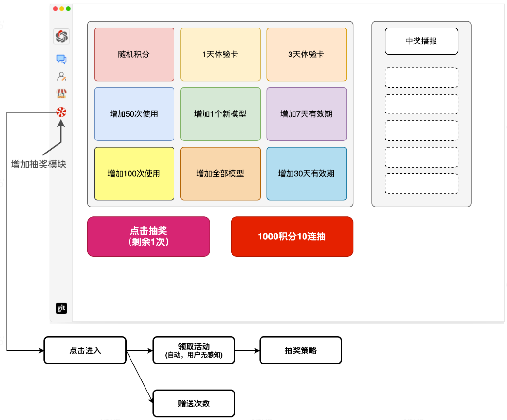

- 用户点击抽奖进入后，则直接赠送抽奖次数。
- 当然这个领取活动的过程，用户是无感知的。


#### 1.2 功能流程

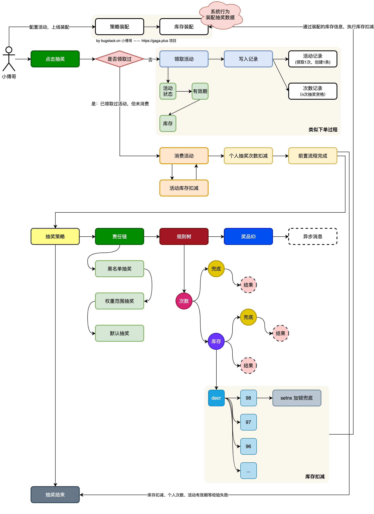

- 大营销的抽奖活动是怎么思考设计的呢？这里其实是抽象为商品购买模型，抽奖策略是具体的商品，商品有多少个，用户怎么消费，我们是抽象为一种下单流程。
- 在这个流程中，用户下单了一个抽奖活动，活动记录了什么时候可以下单、下单后可以参与多少抽奖等记录。如果用户存在下单的抽奖单没有做消费【抽奖】，则在下次抽奖中，会把未消费抽奖单拿出来进行消费，也就是参与抽奖。


#### 1.3 研发设计

- domain 领域是用于承载业务流程拆解出来的领域功能。如已经实现过的 strategy 大营销抽奖策略，后续则需要在 domain 模块下添加一个 activity 模块。
- activity 模块，要提供出参与活动、获得当前领域的活动单，从活动单中获取抽奖策略ID。这样用户抽奖的时候，就拿到了这个策略ID值。【acivity 活动表会配置有策略ID值，一个活动匹配一个策略ID】

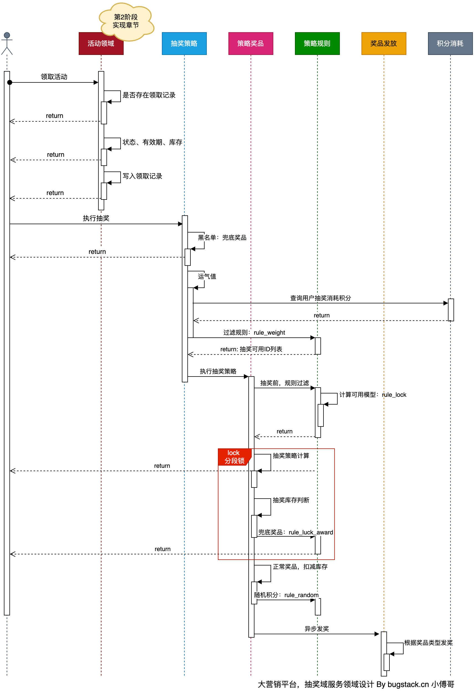


## 二、营销服务

### 1. 用户参与抽奖活动库表设计

在一个营销场景中，抽奖的流程分为：参与的有效期、整体的预算库存、个人的可参与次数、之后是抽奖策略的计算处理，返回抽奖结果。

大营销第1阶段已经完成了抽奖策略的领域模块实现，接下来则需要设计一个外壳，把抽奖策略包装进去。这个外壳就是一个抽奖活动的配置，在活动上有相关的库存、时间、状态，个人在总、日、月分别可进行的参数次数判断。


#### 1.1 业务流程

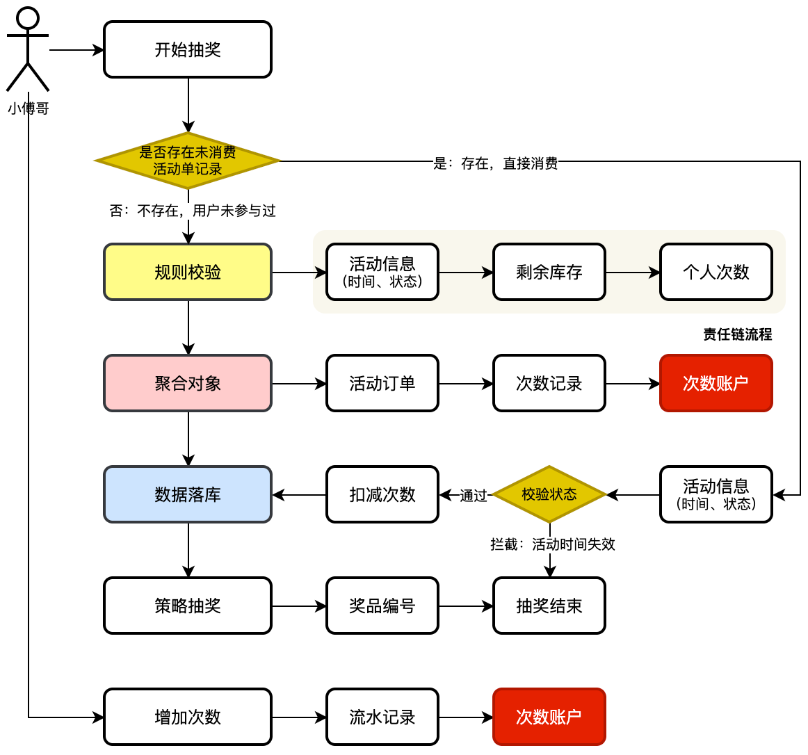

- 我们可以把用户参与抽奖理解为商城的一次下单，下单后才具备参与抽奖的资格。而下单的过程中，则需要过滤活动的相关信息以及库存数据。
- 所有的判断流程做完后开始写入库中，库中则是用户一个互动的次数账户记录。记录着用户可以参与的抽奖次数。同时需要把参与活动的记录写一条订单。
- 此外为了扩展用户在一些场景中，首次【签到/登录】可以赠送一个抽奖次数外，还可以通过购买、做任务、兑换等方式获得新的抽奖次数。这样用户就可以不断地消耗自己的积分兑换抽奖次数来抽奖了。


#### 1.2 库表设计

整个设计分为5张表；两个活动配置表（抽奖活动表、参与次数表）、三个用户领取表（活动下单记录、活动次数账户、账户次数流水）

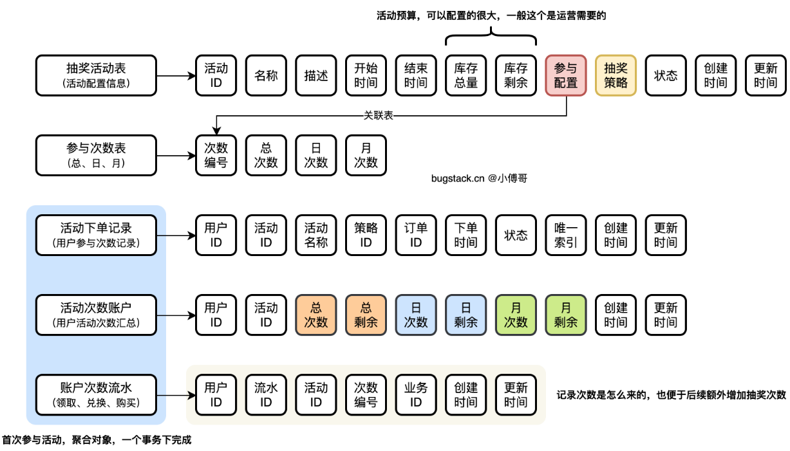

- 抽奖活动表，配置了用户参与一个活动的时候，需要进行的必要信息判断。时间、库存、状态等。
- 参与次数表，单独分离出来。这样更方便后续基于不同的次数编号，做扩展。比如兑换一个新的抽奖次数。
- 活动下单记录表，用户参与活动，则需要先创建一笔订单记录。如果用户抽奖中有失败流程，也可以基于订单的状态，用户重新发起抽奖，也不会额外占用库存记录。
- 活动次数账户表，记录着一个用户在一个活动的可参与次数数据，也就是个人活动账户。
- 账户次数流水表，每一笔对账户变动的记录，无论是任何的方式的变动，都要有一条流水。


### 2. 引入分库分表路由组件

为用户的行为数据，使用路由组件将数据散列到分库分表中。

在大营销的系统设计中，有一个配置库（big_market）和两个分库（big_market_01、big_market_02），我们需要对两个分库进行配置路由操作。达到分库分表的目的，而配置库则是一个单库单表存储活动等配置类信息。

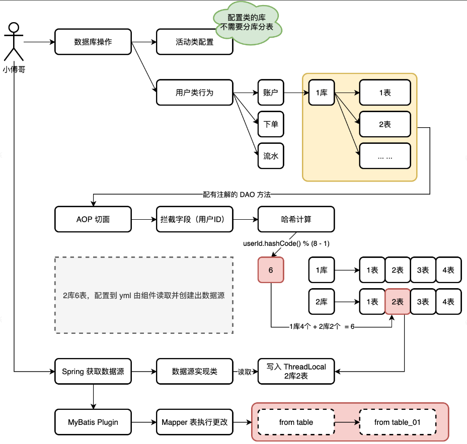


### 3. 抽奖活动订单流程设计

用户参与抽奖活动的流程设计，并可以支持后续满足用户通过不同行为来增加自己的抽奖次数。

对前面所设计的活动库表做一个解耦操作，来满足后续流程中个人可参与抽奖活动次数的变化处理。

我们可以把抽奖的行为理解为一个下单过程，用户参与抽奖，也等价于商品下单。只不过这个商品的 sku 是活动信息。

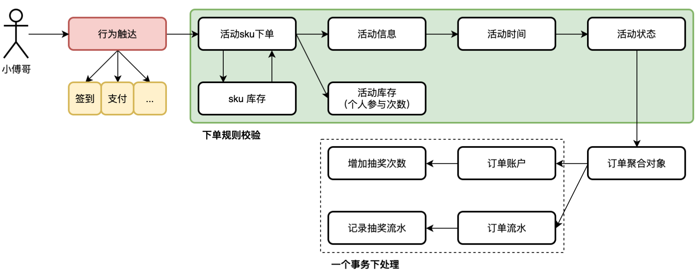


#### 3.1 库表调整

新增加 sku 表，并去掉分库分表中的 flow 流水表，而是直接由 order 订单表提供。


调整前

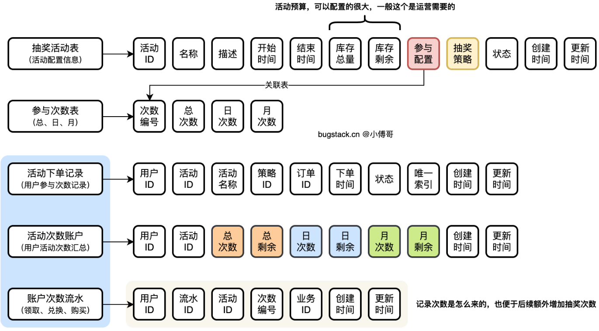


调整后

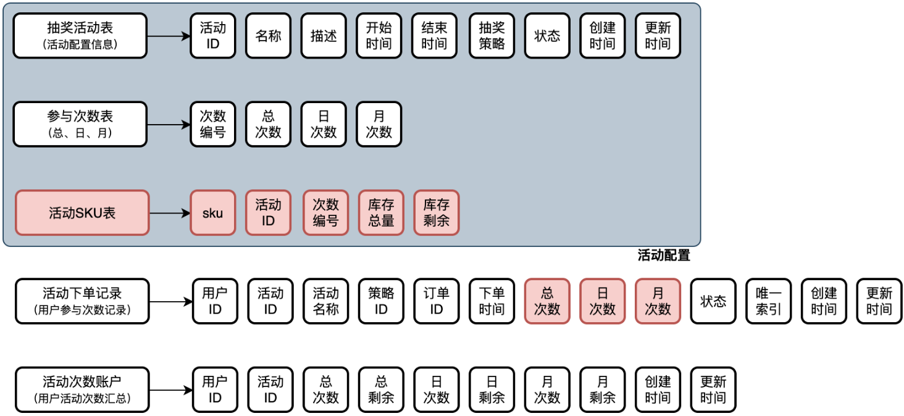


### 4. 抽奖活动流水入库

在基于活动、次数所组合的活动 sku，用户参与活动就相当于，下单sku给自己的活动账户充值可参与的额度次数。

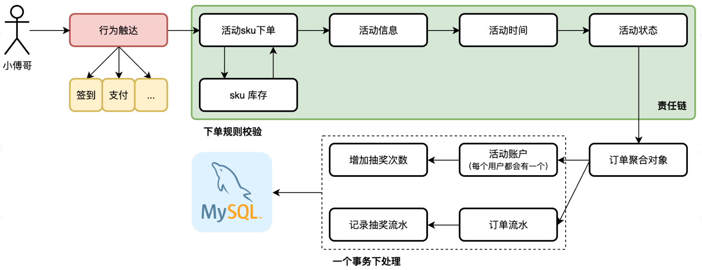


将 写入订单和 更新账户额度次数(或创建账户) 放入同一个事务中。


### 5. 引入MQ处理活动SKU库存一致性

完成活动责任链判断，包括；活动的校验【日期、状态、sku库存】，之后是sku 库存的扣减操作。

之后这里会涉及一个缓存库存和数据库库存一致性问题。

一个手段是之前在策略实现阶段采用的延迟队列做趋势更新。

另外一个是本节要引入 RabbitMQ 在库存消耗空以后发送 MQ 消息，直接更新清空最终库存，保持缓存与数据库的一致性。

**注意**，可能此时缓存消耗库存阶段有失败丢失，不完全等于数据库真实库存。不过没关系，先保证一个统一库存即可。后续可以扫描统计订单数量，来校准库存。

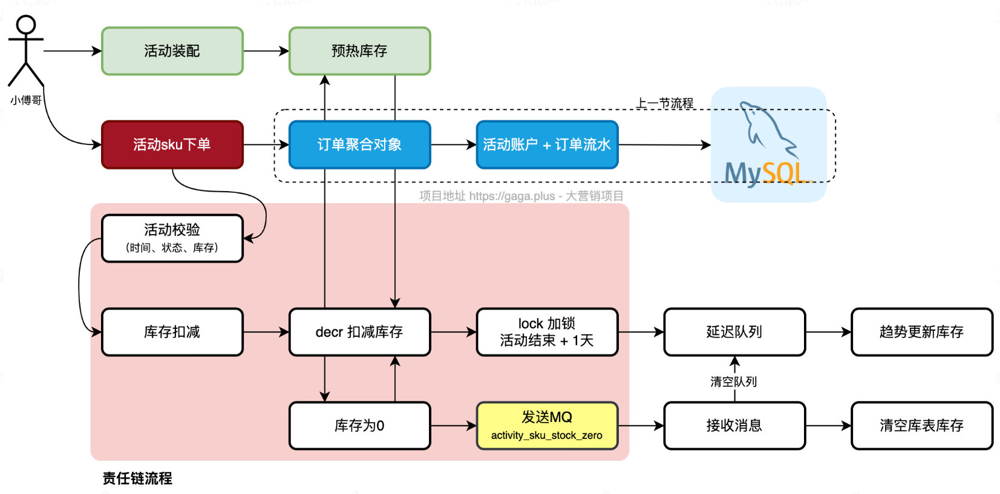


流程：

1. 第一步；完成责任链的活动校验，时间、状态、库存。
2. 第二步；对库存的扣减，使用 decr + lock 锁的方式（兜底）进行处理。
3. 第三步；做完库存扣减后，发送延迟队列，由任务调度更新趋势库存，满足最终一致。
4. 第四步；库存消耗为0后，发送MQ消息，驱动变更数据库库存为0


库存扣减是缓存和数据库分开的。

缓存负责原子性扣除，数据库被延迟队列慢慢扣除。

- 缓存：负责原子性的获取，原子性的放入
- 数据库：被rabbitmq监听，如果库存扣减为0，则发送消息给mq，让mq监听处理数据库库存。


### 6. 用户领取活动库表设计

从用户参与活动，扣减个人活动账户次数，创建活动订单。抽奖完成获得奖品ID后，写入中奖记录和task任务表（发mq补偿使用）。之后发送MQ消息，更新中奖记录。


业务流程

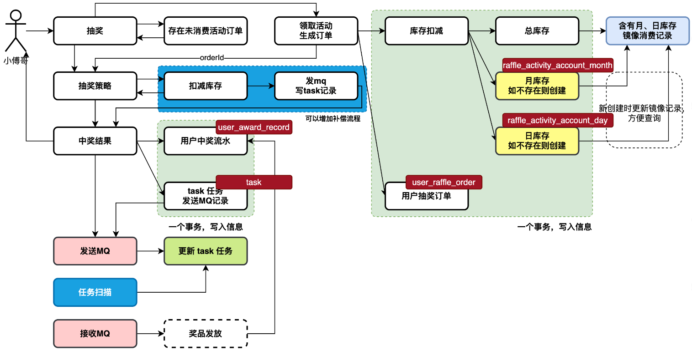


库表设计

设计新增加5章表；活动账户-月参与记录表、活动账户、日参与记录表、用户抽奖订单表、用户中奖记录表；

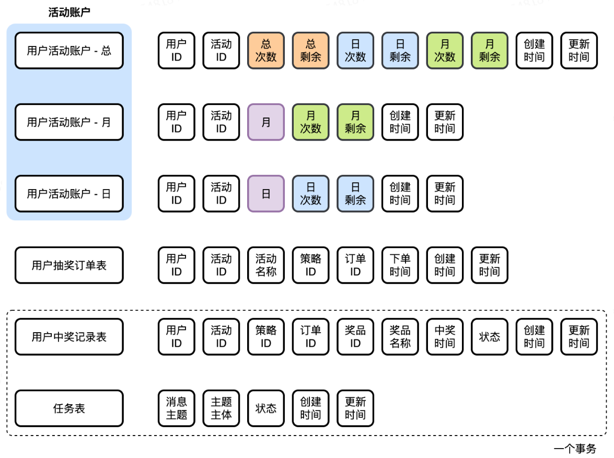


### 7. 领取活动扣减账户额度

添加扣减额度的需求上，对前面实现的活动sku充值，划分下领域。之后在进行新功能的实现。

用户抽奖的业务流程分为；给自己的活动账户添加额度（购买、兑换、打卡），领取活动（扣减互动账户额度）、执行抽奖策略、抽奖结果落库。本节实现到领取活动部分。

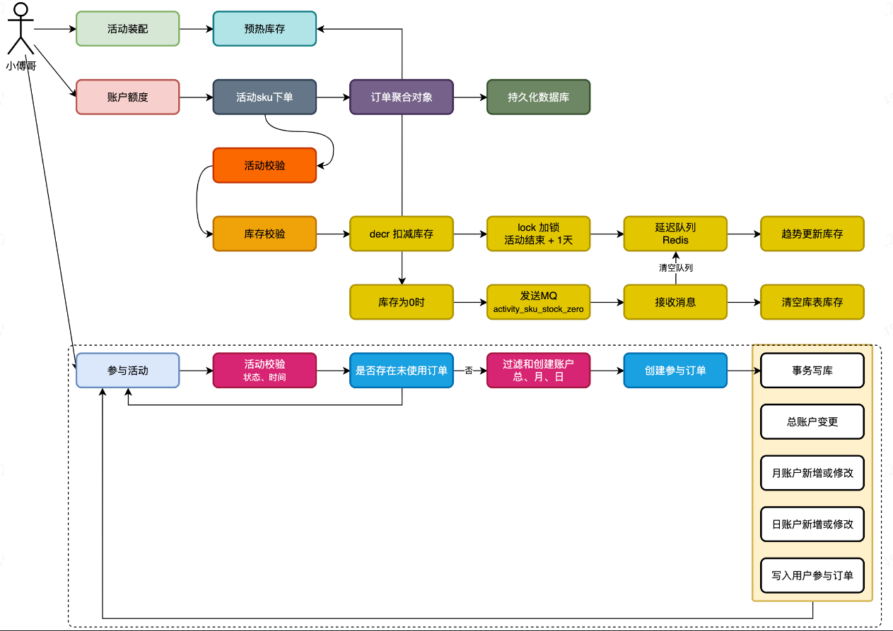


### 8. 写入中奖记录和任务补偿发送MQ

整个抽奖过程先从活动账户额度充值、活动参与、抽奖执行【策略】，之后就是中奖记录写入和后续的发奖。那么本节要实现的就是这里的奖品记录写入和异步消息发送。

会用到 task 任务表，在写入奖品记录的时候，写入一条 task 消息发送任务，作为补偿使用。当 mq 发送失败的时候，则由任务扫描 task 消息进行发送。

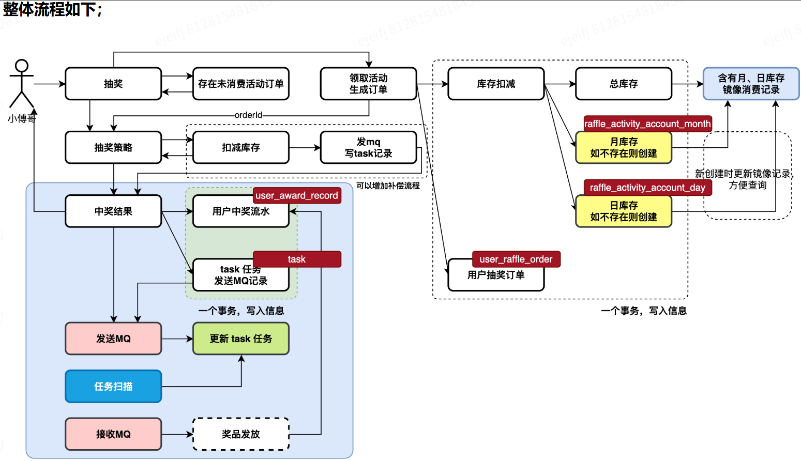


**流程**

中奖消息写入task表，再异步发送mq消息通知奖品分发，无论发送失败或成功都会更新task表状态(成功是completed，失败是fail)。

定时任务查询数据库发送失败的task，进行重试。

最后通过rabbitmq监听消息队列的消息，分发奖品。

- 事务隔离与原子性：通过spring的transactionTemplate确保数据库操作的原子性。 
- 幂等性：通过数据库唯一索引和duplicateKeyException处理。 
- 异步解耦：使用mq实现异步通信，将奖品记录和实际分发解耦。提高系统吞吐量；降低服务间依赖；支持灵活扩展。
- 最终一致性：采用事务+消息补偿的机制：通过定时任务扫描未发送成功的消息进行补偿重试
- 失败处理机制：mq发送失败：记录状态，后续通过定时任务重试；发放奖品失败：在mq消费端实现重试或人工干预；数据库操作失败（DuplicateKeyException e），通过事务回滚。


### 9. 抽奖活动流程串联

以抽奖为流程的各个领域模块已经开发完成，本章我们将串联各个模块提供抽奖API接口。


1. 首先，我们在过往的开发中，我们提供了活动装配、策略装配，所以要单独为装配提供好一个接口来使用。
2. 之后，串联抽奖所需的过程模块，从参数校验、参与活动、抽奖策略、存放结果、更新订单，直至最终返回抽奖结果。

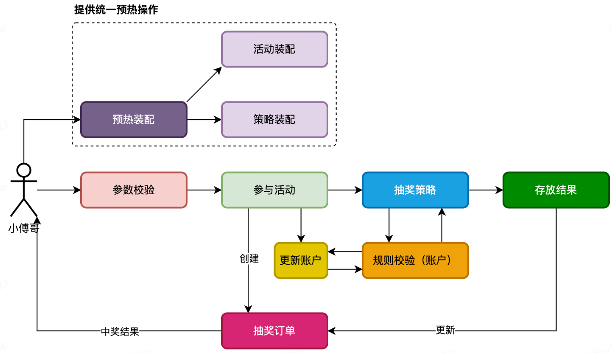


### 10. 活动信息API迭代和功能完善

扩展查询奖品信息接口【queryRaffleAwardList】，以用户活动为视角进行查询增加返回信息。同时修复Redisson序列化、加锁过期时间问题。

整个过程要在策略的查询进行扩展，提供用活动ID+用户ID进行查询。这样才能查询到活动配置配置的信息，用户的抽奖参与次数，以及扩展查询策略的规则（rule_lock）配置。

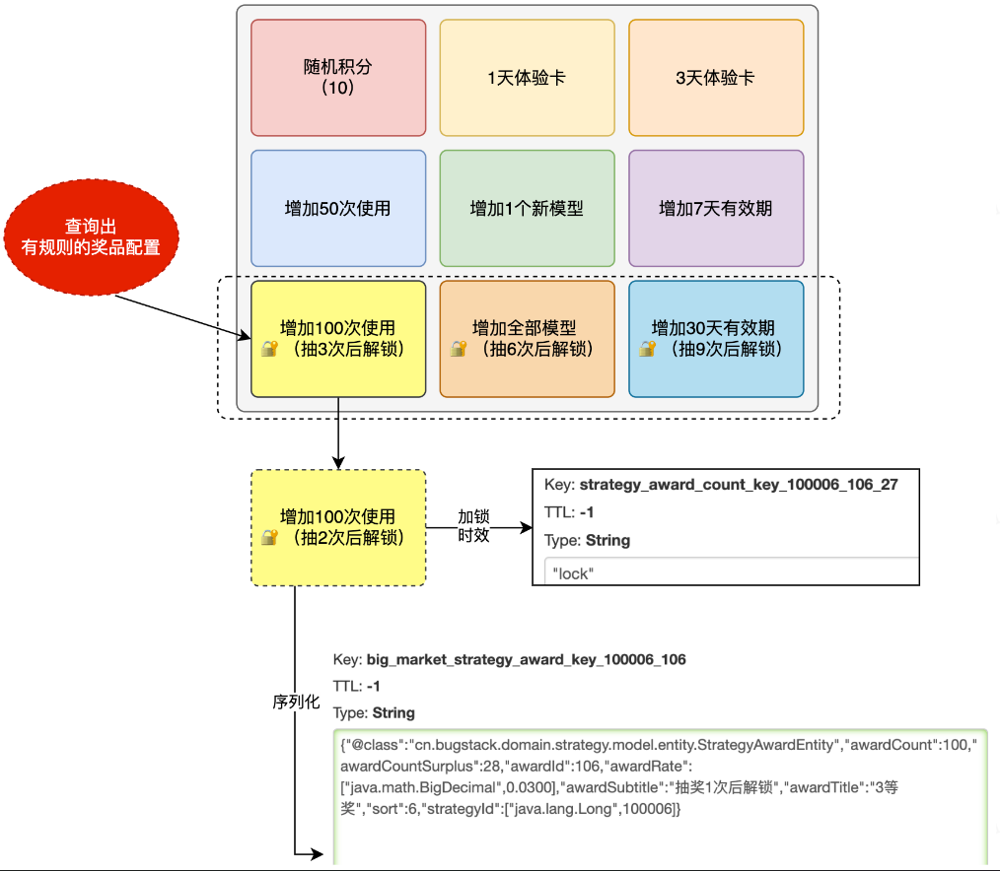


## 三、前端页面

### 1. 活动信息API迭代和功能完善


## 四、需求文档

### 1. 用户行为奖励需求设计

用例图（use case diagram），也称为用户故事，以用户为视角，最简单的展示出用户行为动作。由于其简单纯粹的本质，用例图是项目参与者间交流的好工具。因此也被称为搭建系统的蓝图。

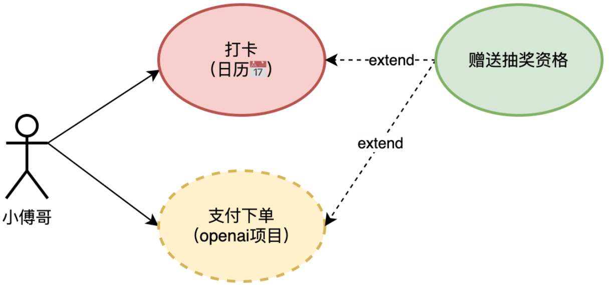


流程图

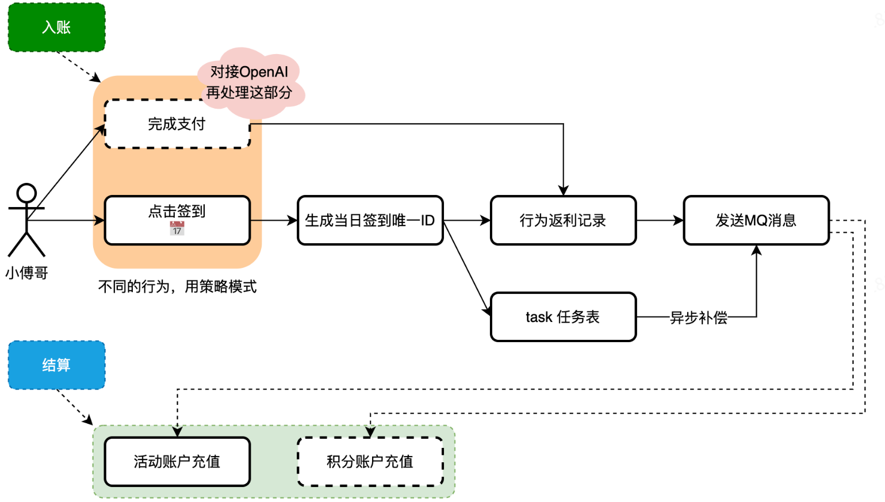


本节会涉及两张库表，一个是日常行为返利的配置表，另外一个是记录用户行为返利流水订单。

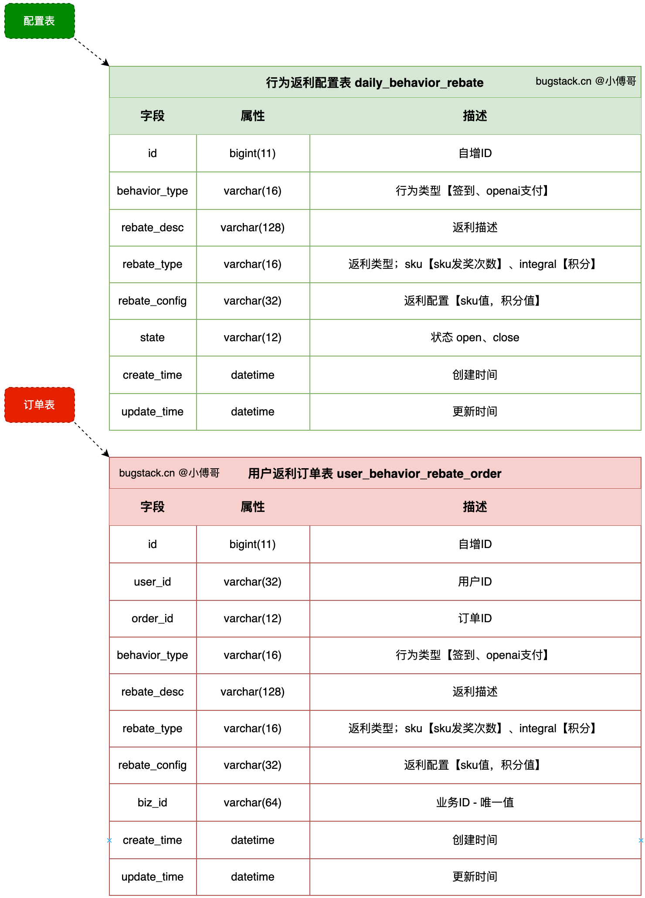


## 五、营销服务

### 1. 用户行为返利入账

比如：你在某个平台创建了新账号，就会给你发一堆的开户优惠券，这些都是日常的返利活动。

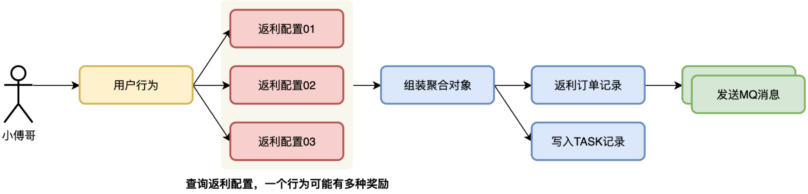


流程

- 把用户的行为动作，根据配置，创建出聚合对象，之后写账入库即可。


### 2. 用户行为返利结算

接收MQ消息开始结算返利，也就是给用户的活动账户充值。

并提供一个日历签到返利的接口，用于后续对接到前端UI使用。

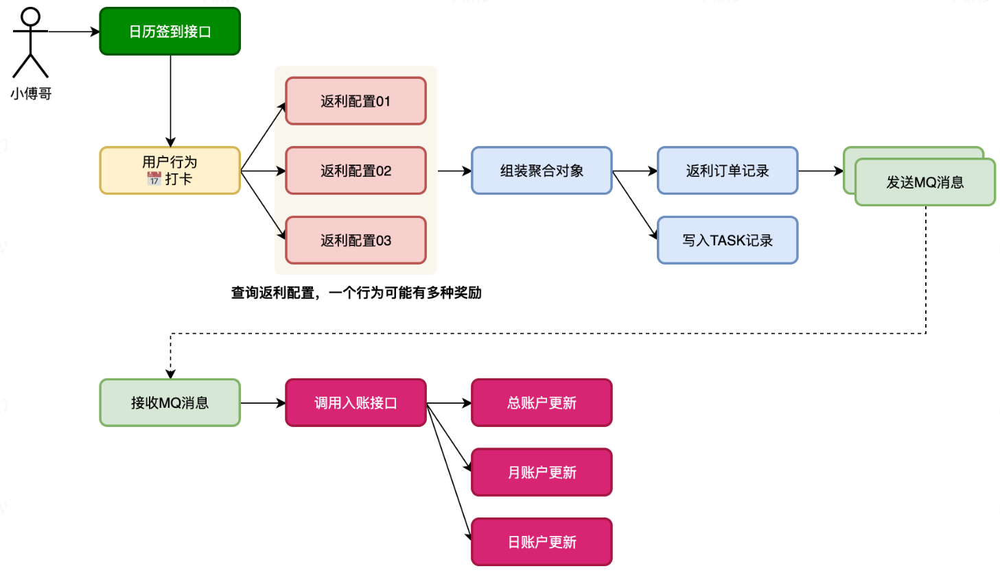


### 3. 规则完善和应用接口实现

完善权重规则的校验，用户的总抽奖次数作为规则权重的比对值，一个活动下抽奖总N次后，可获得必中范围奖品。


# big-market-isjhd-03

## 一、需求文档

### 1. 用户积分需求设计

#### 1.1 本章诉求

分析系统中积分的链路，哪里是添加积分，哪里可以消耗积分。

以积分作为媒介增加用户的营销活动体验。

用户可以知道自己有多少积分，以及在每次完成指定的行为动作后，可以获得积分。


#### 1.2 用例图

在积分的获取和使用上，可以看到3个行为动作来增加和使用积分。

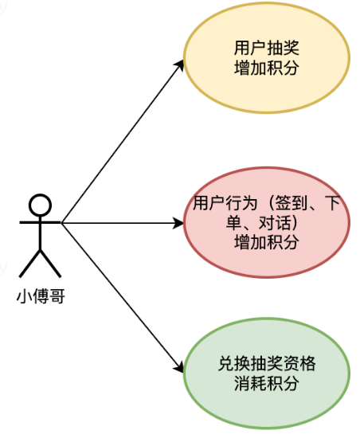

- 抽奖中有随机积分，抽中后可以给用户增加积分。注意黑名单一般会发放一个指定范围的很小的积分值。
- 用户行为动作返利，当用户在抽奖系统中日历📅签到，以及提供出让外部对接的接口，也可以给用户增加积分。
- 最后就是积分消耗，目前这里的积分消耗主要是兑换抽奖资格，也就是和活动 sku 进行兑换。这部分会产生订单。


#### 1.3 流程图

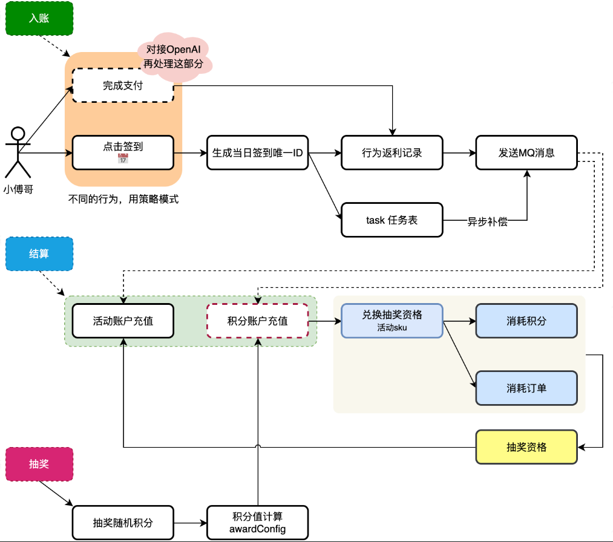


#### 1.4 库表设计

本节我们先做一个积分表的设计，后续开发到积分消耗在开发积分的订单表。

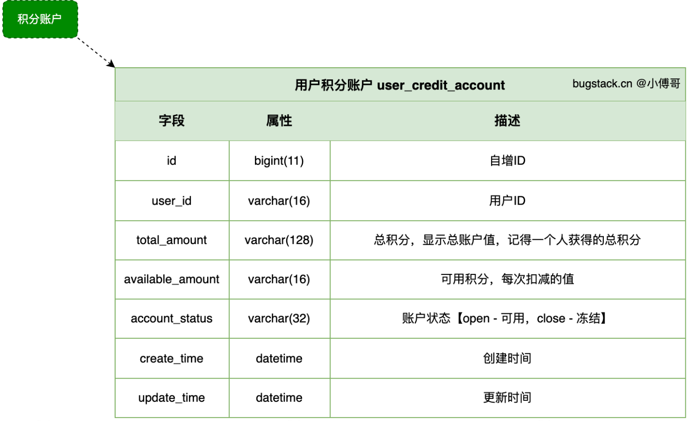


## 二、营销服务

### 1. 积分发奖服务实现

设计用户活动积分流程，创建用户积分表，并开发用户抽奖积分奖品后，完成奖品发放流程，给用户增加积分。

用户的积分是一种中间媒介，抽奖可以获取积分奖品，签到可以获取积分奖品，还可以用积分兑换活动抽奖次数。通过这样的方式把整个抽奖流程闭环。

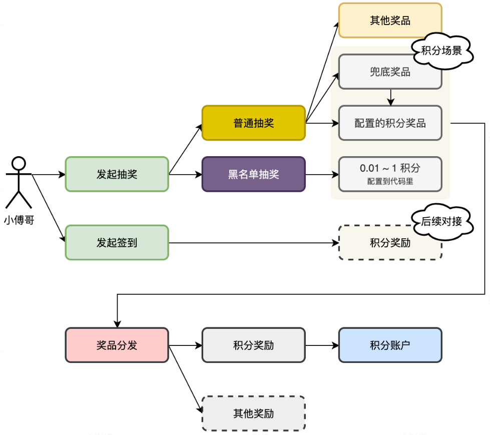


### 2. 积分领域调额服务

增加用户积分领域模块，开发积分调额接口。

串联行为发奖动作，发放用户积分奖励。

这是一整条流程，在设计积分领域模块的时候，要考虑这块模型的功能添加都有哪些，将来可能会存在的接口。如；把对积分账户的增加，抽象为调额。将来使用积分还可以定义出积分消费的接口。我们通过不同的接口做职责的划分。

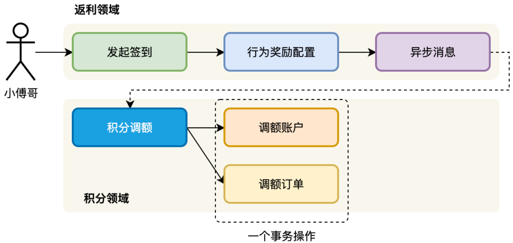

- 首先，设计、定义和开发出积分领域模块，增加积分调额接口。
- 之后，对接返利异步消息，完成积分额度的增加。


### 3. 积分支付兑换商品

开发扣减积分，兑换sku商品，所需的服务模块。让积分的获取、消费，形成逻辑闭环。

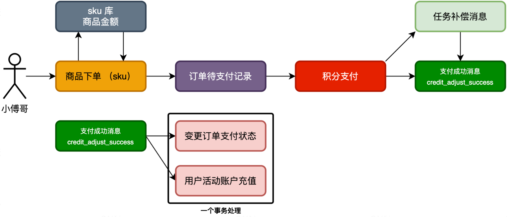

- 首先，对 sku 商品库增加积分金额，用于积分支付，而签到兑换类则无需关注金额。
- 之后，商品下单需要提供出交易策略；无支付交易和有支付交易。
- 最后，下单完成则进行积分抵扣，以及接收到支付成功消息，进行充值入账。


### 4. 积分应用场景接口实现

以支持积分使用「商品、账户、兑换」对接前端诉求，在本节开发所需的接口。

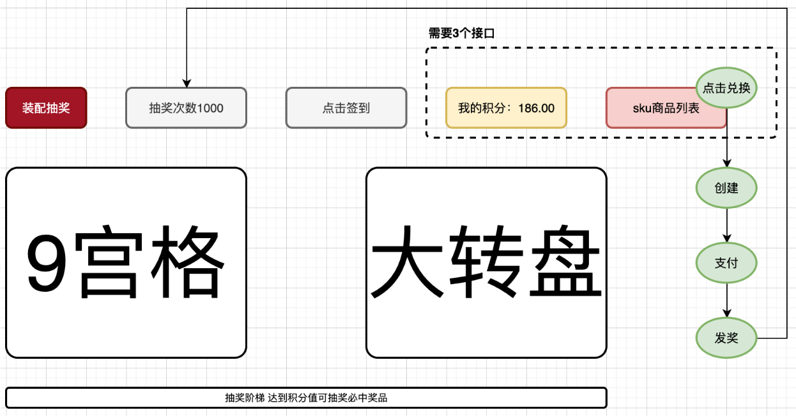

- 虚线框内为本节要为前端UI开发的接口，两个查询积分和商品，一个是操作兑换的处理。
- 注意，兑换的操作会对接口进一步完善，创建下单商品时候会返回未支付订单。这是因为从下单到支付是分开的步骤，可能下单完成，但支付的时候金额不足了「多笔下单场景消费积分」，也可能其他异常导致下单失败。这样的场景都需要把未支付的订单查询出来进行支付。


# big-market-isjhd-04

## 一、开发运维

### 1. 引入Nacos+Dubbo框架

分布式技术栈框架 Nacos + Dubbo，用于微服务间调用，提高信息数据传输效率。

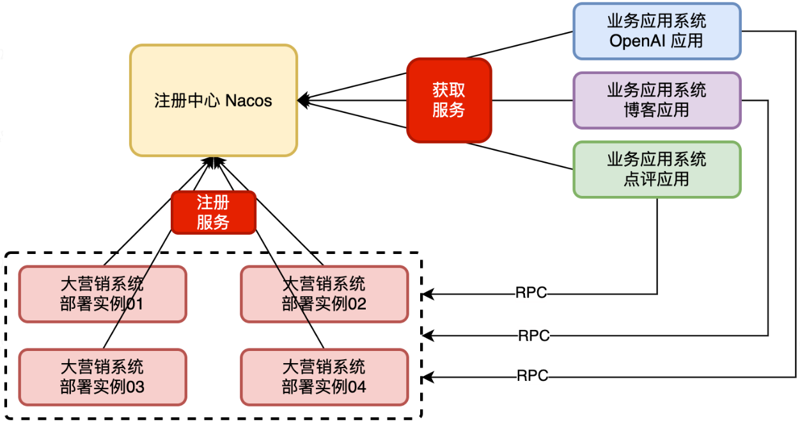

- 首先，Dubbo 这样的 RPC 框架，是比 HTTP 在微服务间的通信效率更高的，所以各个中等规模以上的互联网公司也是更喜欢引入 RPC 框架来解决微服务间通信问题。
- 不过像 Dubbo、SpringCloud，都只是个框架而已，一个系统的核心实现不受框架影响，你可以按照实际诉求，更换或者支持多种通信协议。


## 二、营销服务

### 1. 分布式动态配置活动降级

基于 Zookeeper 实现分布式动态配置中心服务，用于分布式应用节点系统中的环境属性值变更。

这样我们可以让所有分布式系统中，类下的属性值做动态的调整，及时的对系统进行；切量、熔断、降级、黑白名单等用途。

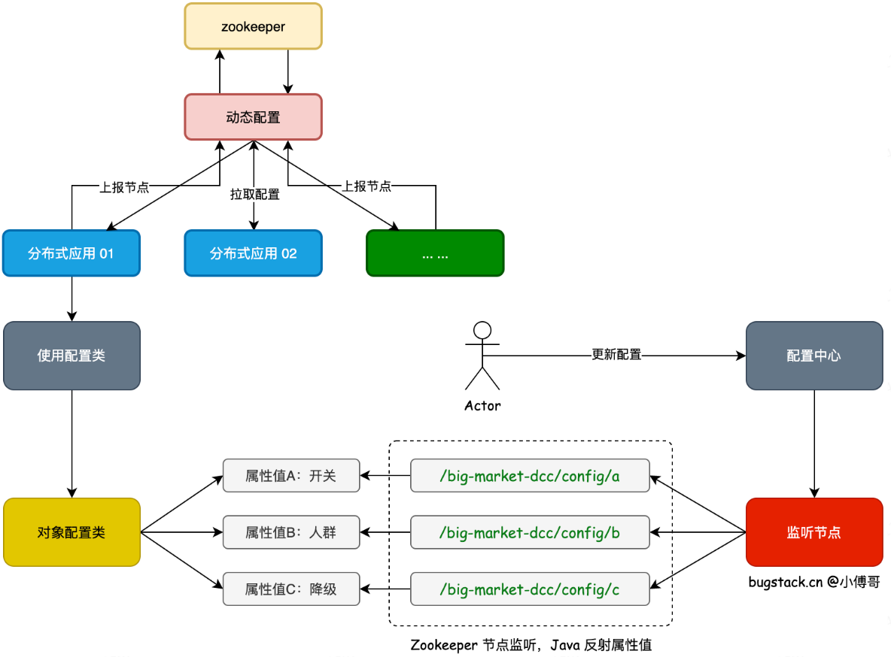


### 2. 分布式动态限流和熔断

增加动态黑名单限流组件，通过访问动态限制将限流用户24H存入本地缓存，通过统一 Dcc 全局配置控制使用。

并在方法上引入接口超时熔断组件。

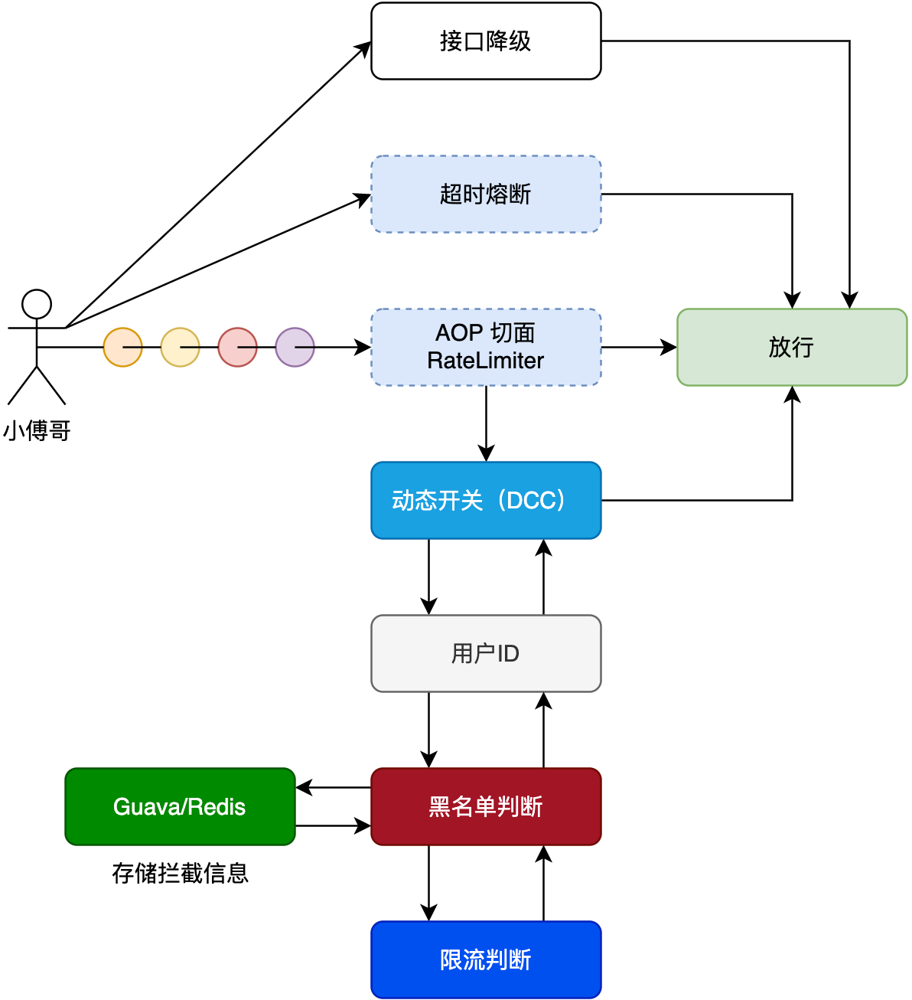

在上一节通过 Zookeeper 实现的动态配置中心 @DCC 服务下，对新增加 RateLimiter 动态限流黑名单服务提供控制管理。

-  首先，因为我们引入切面了，那么上一节 @DCC 直接获取类操作属性的梳理就要考虑代理类的存在了。因为这时候被切面管理的类，在 Spring 中是一个代理对象，而不是原始对象，所以本节还涉及了 DCC 代码的处理。
-  之后，本节要增加的是 RateLimiter 限流，当一个用户频繁访问超过N次后，则会将这个用户加入黑名单列表，不允许在访问当前服务。直至过了超时时间从黑名单列表移走后才允许访问。
-  另外，本节还引入了接口超时熔断组件。降级、熔断、限流，这也是一套分布式微服务非常重要的手段。


### 3. 分库分表数据同步ES

对于C端的场景来说，我们经常会采用分库分表的方案承载数据流量的压力，以用户ID为切分键，让用户的行为数据分散到各个库表中。

那么在C端除了给用户提供数据服务以外，还需要给运营提供数据，但分库分表后的数据都已经散列到各个库表了，对于聚合查询就变得复杂，所以我们还需要另外一套方案。

就是把分散在各个数据库表的数据，通过使用 canal 组件，基于 binlog 日志，把数据同步到 ElasticSearch 文件服务中再提供使用。

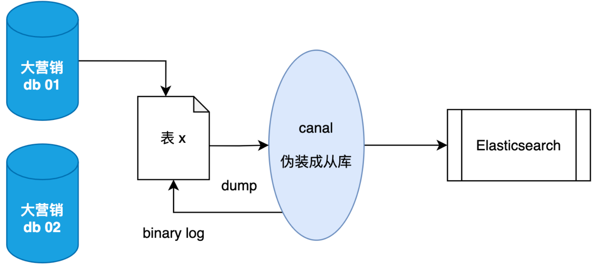

canal ，译为水道/管道/沟渠，主要用途是基于 MySQL 数据库增量日志解析，提供增量数据订阅和消费。

早期阿里巴巴因为杭州和美国双机房部署，存在跨机房同步的业务需求，实现方式主要是基于业务 trigger 获取增量变更。从 2010 年开始，业务逐步尝试数据库日志解析获取增量变更进行同步，由此衍生出了大量的数据库增量订阅和消费业务。

它的工作原理是，canal 模拟 MySQL slave 的交互协议，伪装自己为 MySQL slave ，向 MySQL master 发送dump 协议。在 MySQL master 收到 dump 请求，开始推送 binary log 给 slave (即 canal ) 这样 canal 再解析 binary log （binlog）进行配置分发，同步到 Elasticsearch 等系统中进行使用。

那么有了 canal 就可以把分库分表的数据同步到 Elasticsearch，提供汇总查询和聚合操作，也就不需要把轮训每个分库分表数据了。


### 4. ES-ORM多数据源配置使用

首先是目前已经在 MySQL 分库分表使用的基础上，加入了 canal 组件通过 binlog 日志把分库分表的数据同步 ElasticSearch 文件系统。

那么接下来我们就需要让应用程序可以从 ElasticSearch 查询数据。


- 分库分表是对C端用户的，所有的C端行为一定是有用户ID的。
- canal 同步 ElasticSearch 是为了给运营端做数据聚合查询的，一般这类的查询是不做核心业务的，因为同步是有时效性的。


### 5. xxl-job分布式任务调度

增加 xxl-job 分布式任务调度服务，处理大营销中：发送MQ消息任务队列、更新活动sku库存任务、更新奖品库存任务定时任务。

同时因为整个大营销是分布式部署，一套 big-market 会被多个应用实例一起部署，那么就会有多个实例上相同的一个任务要执行，这个时候需要增加抢占式锁，避免造成重复执行。


### 6. 增强抽奖算法策略

在实际生产场景中，运营的奖品配置概率有时候百分位或者千分位，也就是小数点后有几个0，但有时候也有需要配置到万分位或者百万分位，来降低大奖的奖品概率配置。

对于不同概率的抽奖配置，我们也有为它设计出不同的抽奖算法策略。让万分位以下的这类频繁配置的，走O(1)时间复杂度。而对于超过万分位的，可以考虑循环对比，但在循环对比的中，还要根据奖品的数量设定出不同的计算模型。如；O(n)、O(logn) 如图；


- 算法1；是O(1) 时间复杂度算法，在抽奖活动开启时，将奖品概率预热到本地(Guava)/Redis。如，10%的概率，可以是占了1~10的数字区间，对应奖品A。11~15 对应奖品B。那么在抽奖的时候，直接用生成的随机数通过对 map 进行 get 即可。
- 算法2；是O(n) ~ O(logn)算法，当奖品概率非常大的时候，达到几十万以上，我们就适合在本地或者 Redis 来初始化这些数据存到 Map 里了。那么这个时候就要把奖品概率，拆分为一个个有限定范围的格子区间。比如 1~7900代表一个奖品、7901~8200代表另外一个奖品，把这些数据存储到 `Map<Map<Integer,Integer>,Integer>` 在抽奖的时候通过产生的随机值来与这些范围区间依次进行对比。那么为了更好的优化抽奖算法，可以的分别对<=8的进行for循环、<=16的二分查找、>16的进行多线程计算。因为熟练很小开启多线程的资源也是一种消耗。


通过设计模式解耦代码流程，把职责分离，这样我们在迭代的时候才能更好的找到每一块功能的实现边界。让迭代需求变得容易一些，也减少一些错误发生。


- 如图，左侧通过接口、抽象类的模板方法，定义抽奖装配和抽奖算法的执行过程。之后有抽奖策略算法实现类完成功能细节。
- 如图，右侧通过接口和抽象类，设计抽奖算法标准结构。之后分别实现O(1)、O(Logn)代码实现流程。


# big-market-isjhd-05

## 一、营销服务

### 1. 对接OpenAI项目额度奖品拼接

OpenAI 业务项目是一个以售卖额度提供 ChatGLM、ChatGPT 各类服务为载体的 OpenAI 业务应用。

大营销项目就可以结合到 OpenAI 应用项目中提供积分、兑换、返利、抽奖这样的服务模块。

增强 OpenAI 业务项目的拉新、促活、留存用户的能力。

整个对接过程分为2个阶段：

- 一个是 OpenAI 项目提供账户调额能力作为奖品接口给大营销使用。
- 另外一个是 OpenAI 项目，对接大营销的 RPC/HTTP 接口，搭建营销活动页。


### 2. 营销页面接口封装

在前端工程 chatgpt-web 中添加营销UI和接口对接。


- openai 项目后端服务，提供账户额度接口。
- big-market 大营销服务，提供积分、抽奖、签到、兑换，过程中的查询和使用接口。


### 3. RPC接口对接支付返利

通过在大营销 big-market 新增提供的通用返利 RPC 接口，由 OpenAI 服务 chatgpt-data 系统在支付完成接收到回调消息后进行对接完成返利动作。


- 用户下单完成支付后，会接收到支付消息，之后调用大营销提供的返利接口进行返利。返利为：积分和抽奖次数。


### 4. 活动上架发布预热对接

一个互联网中对外发布抽奖、发券、拉新等行为活动设计的通用方案。

在实际运营作业中，会创建出很多的活动，这些活动会被分配到不同渠道给不同来源进行使用。

这里就要有一个活动上架平台，让外部调用方根据传入的SC值，也就是渠道和来源调用到这一方可以使用的当前的活动ID。


- 首先，运营负责把活动上架，点击审核为有效。有效后，也就是在这个时间点把活动预热到 Redis，在咱们大营销中的预热操作是装配的接口，会在这个过程中调用。
- 之后，用户从前端页面进入后，程序会查询到当前上架的活动，这样就明确了具体参与到哪个活动上了。


