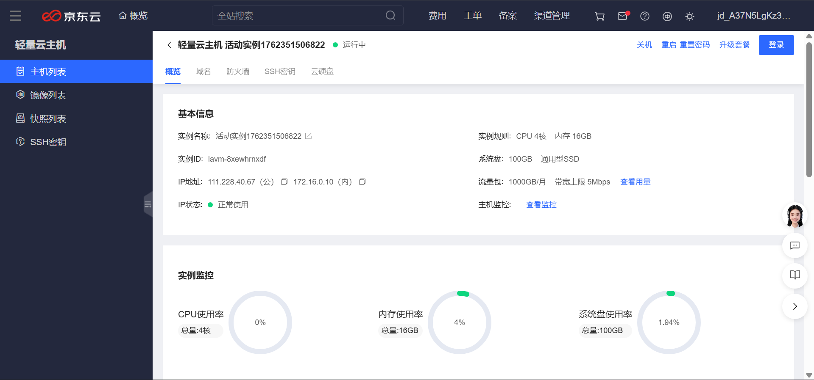
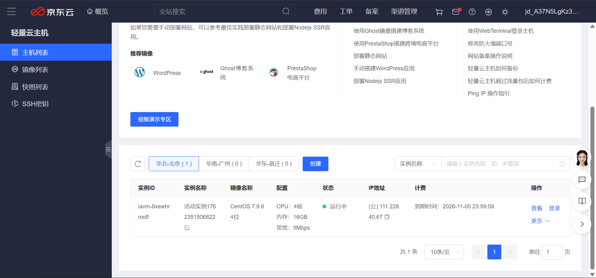
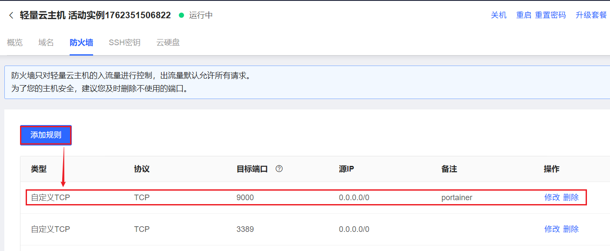
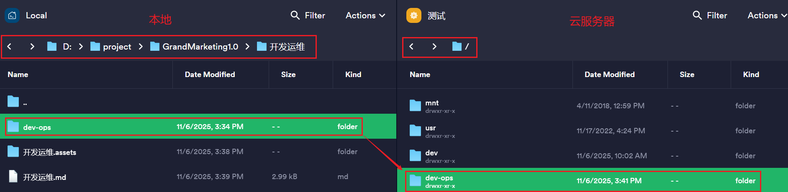
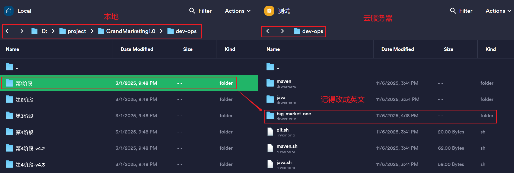
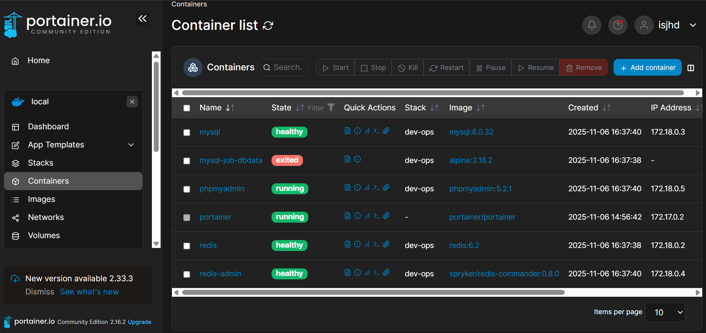
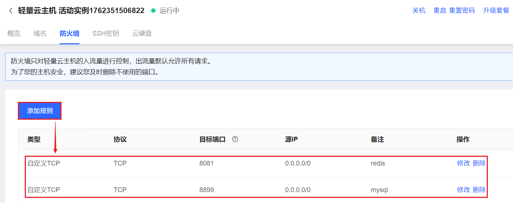
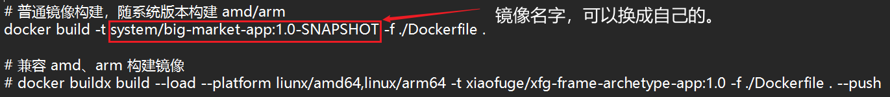
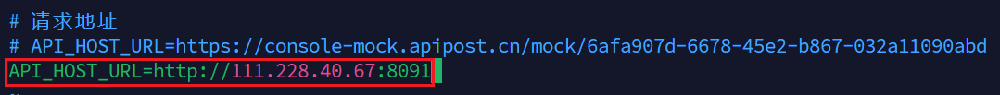

# 开发运维

## 一、选购云服务器

云服务器优惠指南：https://618.gaga.plus/

记得设置密码

## 二、Docker安装

1. ssh连接到云服务器

2. 连接成功后

- 查看linux内核版本：uname -r
- yum 更新到最新版本：sudo yum update
- 安装Docker所需的依赖包：sudo yum install -y yum-utils device-mapper-persistent-data lvm2
- 设置Docker的yum的源：sudo yum-config-manager --add-repo https://mirrors.aliyun.com/docker-ce/linux/centos/docker-ce.repo
- 查看你所能安装的docker版本：yum list docker-ce --showduplicates | sort -r
- 安装docker：sudo yum install -y docker-ce-25.0.5 docker-ce-cli-25.0.5 containerd.io

> 如果出错，自行上网解决
>

启动docker并添加开机自启动

1. sudo systemctl start docker
2. systemctl enable docker
3. sudo systemctl restart docker

设置docker的镜像源

- 【推荐】1panel 提供了镜像源 https://status.1panel.top/status/docker (opens new window)- 直接进去就可以找到最新的镜像源
- 阿里云提供了镜像源：https://cr.console.aliyun.com/cn-hangzhou/instances/mirrors (opens new window)- 登录后你会获得一个专属的地址。

使用以下命令来设置 Docker 国内源：- 或者你可以通过 `vim /etc/docker/daemon.json` 进入修改添加 registry-mirrors 内容后重启 Docker

1. sudo mkdir -p /etc/docker
2. sudo tee /etc/docker/daemon.json <<-'EOF'
   {"registry-mirrors": ["https://docker.1ms.run",
       "https://docker.1panel.live",
       "https://docker.ketches.cn"]}
   EOF
3. sudo systemctl daemon-reload
4. sudo systemctl restart docker

### 1. 安装Docker-Compose

> 定义和运行多容器 Docker 应用的工具。通过编写 *docker-compose.yml* 文件，可以轻松管理多个容器的启动、停止和配置。

1. 指定路径【推荐】：sudo curl -L https://gitee.com/fustack/docker-compose/releases/download/v2.24.1/docker-compose-linux-x86_64 -o /usr/local/bin/docker-compose
2. 设置权限：sudo chmod +x /usr/local/bin/docker-compose

### 2. Docker管理面板(Portainer)

1. 拉取最新的 Portainer：docker pull portainer/portainer
2. 启动：docker run -d --restart=always --name portainer -p 9000:9000 -v /var/run/docker.sock:/var/run/docker.sock portainer/portainer
3. 开机自启动：docker update --restart=always portainer

打开防火墙

访问portainer

http://111.228.40.67:9000/

设置账号和密码

## 三、基本环境部署

### 1.git、Java、Maven

1. cd /dev-ops/

安装git

1. chmod +x git.sh
2. ./git.sh

安装java

1. chmod +x java.sh
2. ./java.sh
3. 如果java -version没看到版本，使用source /etc/profile刷新一下

安装maven

1. chmod +x maven.sh
2. ./maven.sh
3. 如果mvn -version没看到版本，使用source /etc/profile刷新一下

## 四、大营销第一阶段初始化

1. cd /dev-ops/big-market-one/dev-ops
2. chmod +x docker-compose-environment.yml
3. docker-compose -f docker-compose-environment.yml up -d

结果

打开防火墙

访问

http://111.228.40.67:8899/，账号：root，密码：123456。

http://111.228.40.67:8081/，账号：admin，密码：admin。

## 五、第一阶段完成抽奖部署

1. 拉取远程仓库的后端代码：git clone https://gitcode.com/isjhd40/big-market-isjhd-01.git

2. cd big-market-isjhd-01/

3. 打包：mvn clean install

4. cd big-market-app，其中有build.sh

5. chmod +x build.sh

   

6. ./build.sh

7. 查看镜像：docker images

1. 拉取远程仓库的前端代码：git clone https://gitcode.net/KnowledgePlanet/big-market/big-market-front.git

2. cd big-market-front/

3. 查看分支：git branch -a

4. git checkout 240217-xfg-dev-ops-tag-raffle

5. chmod +x build.sh

6. ./build.sh

7. cd ..

8. cd ..

9. cd dev-ops

10. chmod +x docker-compose-app.yml

11. docker-compose -f docker-compose-app.yml up -d

12. cd big-market-front/

13. touch .env.local

14. vim .env.local，然后修改为自己的ip地址

    

15. 再次删掉前后端镜像，重新部署

## 六、部署<域名+ssl配置>

百度云申请域名：isjhd.online

ssl配置通过 httpsok.com

## 七、运营后台

