# take-out(瑞吉外卖)

## 前置知识

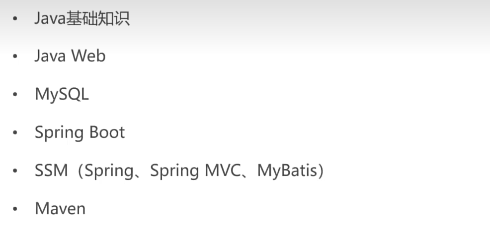


## 学习收获

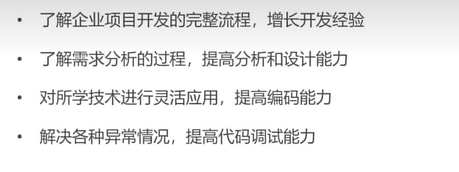


## 软件开发整体介绍

### 软件开发流程

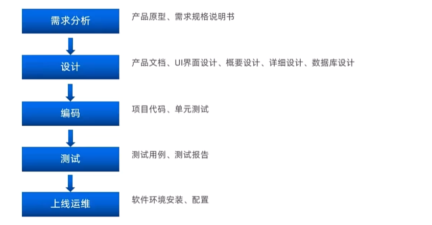

### 角色分工


### 软件环境

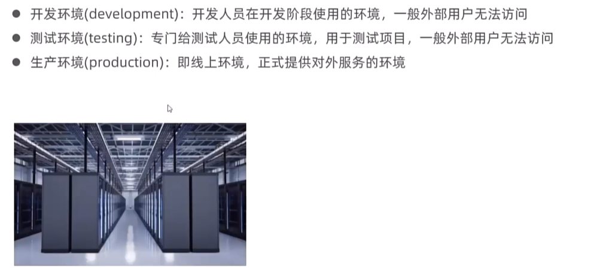


## 瑞吉外卖项目介绍

### 项目介绍


### 产品原型展示

产品原型，就是一款产品成型之前的一个简单的框架，就是将页面的排版布局展现出来，使产品的初步构思有一个可视化的展示。通过原型展示，可以更加直观的了解项目的需求和提供的功能。

**注意事项**：产品原型主要用于展示项目的功能，并不是最终的页面效果。

### 技术选型

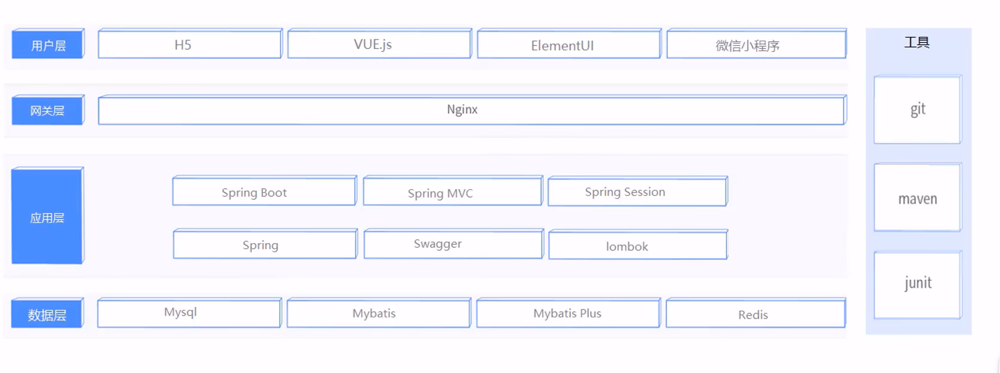

### 功能架构

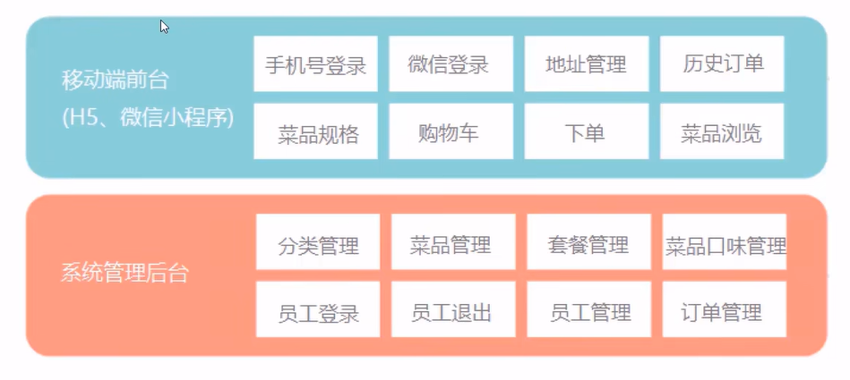

### 角色

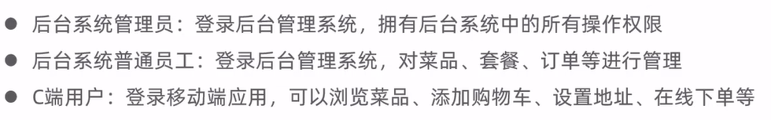


## 开发环境搭建

### 数据库环境搭建

创建项目对应的数据库(图形界面或者命令行都可以)

导入表结构(资料/数据模型/db_reggie.sql)
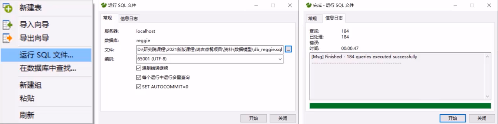

数据表
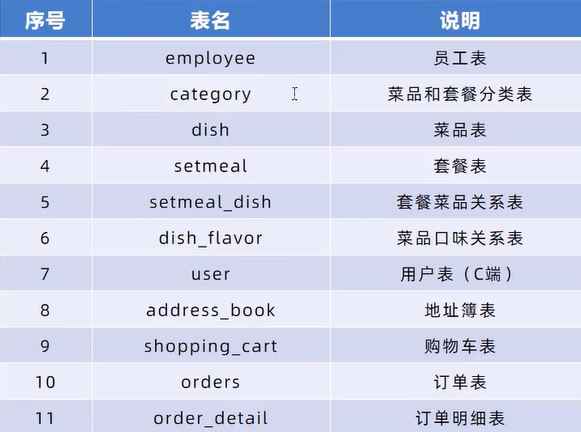


### maven项目搭建

#### 1 ）创建maven项目

#### 2 ）导入pom.xml文件

```xml
<project xmlns="http://maven.apache.org/POM/4.0.0" xmlns:xsi="http://www.w3.org/2001/XMLSchema-instance"
  xsi:schemaLocation="http://maven.apache.org/POM/4.0.0 http://maven.apache.org/maven-v4_0_0.xsd">
  <modelVersion>4.0.0</modelVersion>

  <parent>
    <groupId>org.springframework.boot</groupId>
    <artifactId>spring-boot-starter-parent</artifactId>
    <version>2.4.5</version>
    <relativePath/> <!-- lookup parent from repository -->
  </parent>

  <groupId>com.isjhd</groupId>
  <artifactId>reggie_take_out</artifactId>
  <version>1.0-SNAPSHOT</version>
  <properties>
    <java.version>1.8</java.version>
  </properties>

  <dependencies>

    <dependency>
      <groupId>org.springframework.boot</groupId>
      <artifactId>spring-boot-starter</artifactId>
    </dependency>

    <dependency>
      <groupId>org.springframework.boot</groupId>
      <artifactId>spring-boot-starter-test</artifactId>
      <scope>test</scope>
    </dependency>

    <dependency>
      <groupId>org.springframework.boot</groupId>
      <artifactId>spring-boot-starter-web</artifactId>
      <scope>compile</scope>
    </dependency>

    <dependency>
      <groupId>com.baomidou</groupId>
      <artifactId>mybatis-plus-boot-starter</artifactId>
      <version>3.4.2</version>
    </dependency>

    <dependency>
      <groupId>org.projectlombok</groupId>
      <artifactId>lombok</artifactId>
      <version>1.18.20</version>
    </dependency>

    <dependency>
      <groupId>com.alibaba</groupId>
      <artifactId>fastjson</artifactId>
      <version>1.2.76</version>
    </dependency>

    <dependency>
      <groupId>commons-lang</groupId>
      <artifactId>commons-lang</artifactId>
      <version>2.6</version>
    </dependency>

    <dependency>
      <groupId>mysql</groupId>
      <artifactId>mysql-connector-java</artifactId>
      <scope>runtime</scope>
    </dependency>

    <dependency>
      <groupId>com.alibaba</groupId>
      <artifactId>druid-spring-boot-starter</artifactId>
      <version>1.1.23</version>
    </dependency>

  </dependencies>

  <build>
    <plugins>
      <plugin>
        <groupId>org.springframework.boot</groupId>
        <artifactId>spring-boot-maven-plugin</artifactId>
        <version>2.4.5</version>
      </plugin>
    </plugins>
  </build>
</project>
```


#### 3 ）导入SpringBoot配置文件application.yml

```yaml
server:
  port: 8080
spring:
  application:
    #应用名称，可选
    name: reggie_take_out
  datasource:
    druid:
      driver-class-name: com.mysql.cj.jdbc.Driver
      url: jdbc:mysql://localhost:3306/reggie?serverTimezone=Asia/Shanghai&useUnicode=true&characterEncoding=utf-8&zeroDateTimeBehavior=convertToNull&useSSL=false&allowPublicKeyRetrieval=true
      username: root
      password: hsp
mybatis-plus:
  configuration:
    #在映射实体或者属性时，将数据库中表名和字段名中的下划线去掉，按照驼峰命名法映射
    map-underscore-to-camel-case: true
    log-impl: org.apache.ibatis.logging.stdout.StdOutImpl
  global-config:
    db-config:
      id-type: ASSIGN_ID
```


#### 4 ）导入前端资源

new一个config/WebMvcConfig.java类设置静态资源

```java
@Slf4j
@Configuration
public class WebMvcConfig extends WebMvcConfigurationSupport {

    /**
     * 设置静态资源映射
     * @param registry
     */
    @Override
    protected void addResourceHandlers(ResourceHandlerRegistry registry) {
        log.info("开始进行静态资源映射...");
        registry.addResourceHandler("/backend/**").addResourceLocations("classpath:/backend/");
        registry.addResourceHandler("/front/**").addResourceLocations("classpath:/front/");
    }
}
```


## 后台登录功能开发

### 需求分析

#### 1 ）页面原型展示

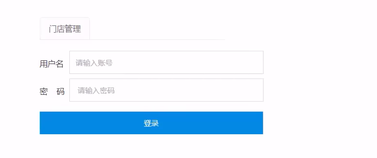

#### 2 ）登录页面展示


#### 3 ）查看登录请求信息

通过浏览器调试工具(F12)，可以发现，点击登录按钮时，页面会发送请求（请求地址为http://localhost:8080/employee/login）并提交参数(username和password)

此时报404，是因为我们的后台系统还没有响应此请求的处理器，所以我们需要创建相关类来处理登录请求

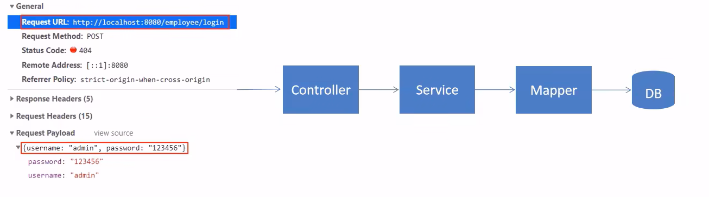

#### 4 ）数据模型(employee表)

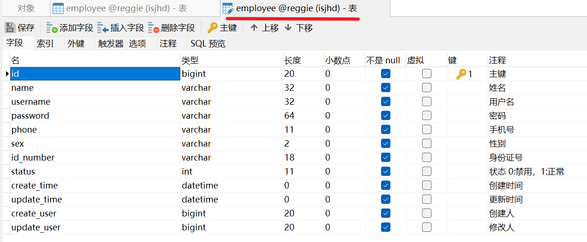


### 代码开发

#### 1 ）创建实体类Employee，和employee表进行映射

```java
@Data
public class Employee implements Serializable {

    private static final long serialVersionUID = 1L;

    private Long id;

    private String username;

    private String name;

    private String password;

    private String phone;

    private String sex;

    private String idNumber;//身份证号码

    private Integer status;

    private LocalDateTime createTime;

    private LocalDateTime updateTime;

    @TableField(fill = FieldFill.INSERT)
    private Long createUser;

    @TableField(fill = FieldFill.INSERT_UPDATE)
    private Long updateUser;

}
```


#### 2 ）创建Controller、Service、Mapper

**mapper/EmployeeMapper**

```java
@Mapper
public interface EmployeeMapper extends BaseMapper<Employee> {

}
```


**service/EmployeeService**

```java
public interface EmployeeService extends IService<Employee> {

}
```


**service/impl/EmployeeServiceImpl**

```java
@Service
public class EmployeeServiceImpl extends ServiceImpl<EmployeeMapper, Employee> implements EmployeeService {
}
```


**controller/EmployeeController**

```java
@Slf4j
@RestController
@RequestMapping("/employee")
public class EmployeeController {

    @Autowired
    private EmployeeService employeeService;

}
```


#### 3 ）导入返回结果类R

此类是一个通用结果类，服务端响应的所有结果最终都会包装成此种类型返回给前端页面

```java
/**
 * 通用返回结果，服务端响应的数据最终都会封装成此对象
 * @param <T>
 */
@Data
public class R<T> {

    private Integer code; //编码：1成功，0和其它数字为失败

    private String msg; //错误信息

    private T data; //数据

    private Map map = new HashMap(); //动态数据

    public static <T> R<T> success(T object) {
        R<T> r = new R<T>();
        r.data = object;
        r.code = 1;
        return r;
    }

    public static <T> R<T> error(String msg) {
        R r = new R();
        r.msg = msg;
        r.code = 0;
        return r;
    }

    public R<T> add(String key, Object value) {
        this.map.put(key, value);
        return this;
    }

}
```


#### 4 ）在Controller中创建登录方法

处理逻辑如下：
1、将页面提交的密码password进行md5加密处理
2、根据页面提交的用户名username查询数据库
3、如果没有查询到则返回登录失败结果
4、密码比对，如果不一致则返回登录失败结果
5、查看员工状态，如果为已禁用状态，则返回员工已禁用结果
6、登录成功，将员工id存入Session并返回登录成功结果
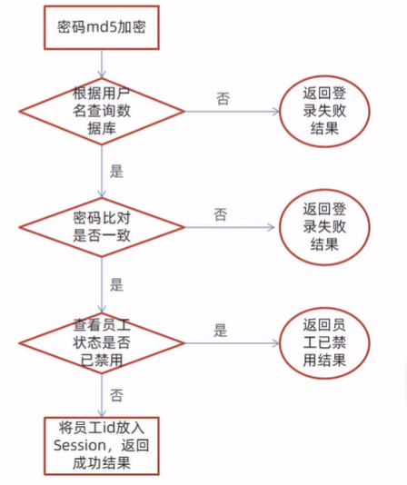


#### 5 ）后台退出功能开发

**需求分析**
员工登录成功后，页面跳转到后台系统首页面(backend/index.html),此时会显示当前登录用户的姓名：
如果员工需要退出系统，直接点击右侧的退出按钮即可退出系统，退出系统后页面应跳转回登录页面

**代码开发**
用户点击页面中退出按钮，发送请求，请求地址为/employee/logout,请求方式为POST。
我们只需要在Controller中创建对应的处理方法即可，具体的处理逻辑：
1、清理Session中的用户id
2、返回结果


### 完善登录功能

**问题分析**
前面我们已经完成了后台系统的员工登录功能开发，但是还存在一个问题：用户如果不登录，直接访问系统首页面，照样可以正常访问。

这种设计并不合理，我们希望看到的效果应该是，只有登录成功后才可以访问系统中的页面，如果没有登录则跳转到登录页面。

那么，具体应该怎么实现呢？
答案就是使用过滤器或者拦截器，在过滤器或者拦截器中判断用户是否已经完成登录，如果没有登录则跳转到登录页面。

**代码实现**
实现步骤：
1、创建自定义过滤器LoginCheckFilter
2、在启动类上加入注解@ServletComponentScan
3、完善过滤器的处理逻辑

**代码实现**
过滤器具体的处理逻辑如下：
1、获取本次请求的URl
2、判断本次请求是否需要处理
3、如果不需要处理，则直接放行
4、判断登录状态，如果已登录，则直接放行
5、如果未登录则返回未登录结果
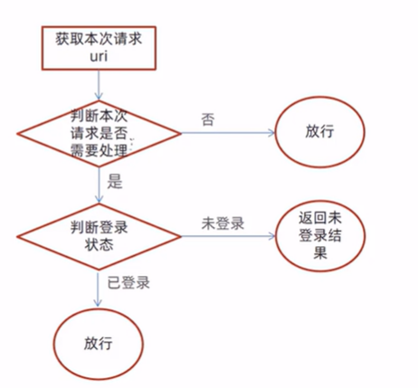


### 新增员工

**需求分析**
后台系统中可以管理员工信息，通过新增员工来添加后台系统用户。点击【添加员工】按钮跳转到新增页面。

**数据模型**
新增员工，其实就是将我们新增页面录入的员工数据插入到employee表。需要注意，employee表中对username字段加入了唯一约束，因为username是员工的登录账号，必须是唯一的。

employee表中的status字段已经设置了默认值1，表示状态正常。

**代码开发**
在开发代码之前,需要梳理一下整个程序的执行过程:
1、页面发送ajax请求,将新增员工页面中输入的数据以json的形式提交到服务端
2、服务端Controller接收页面提交的数据并调用Service将数据进行保存
3、Service调用Mapper操作数据库,保存数据

前面的程序还存在一个问题,就是当我们在新增员工时输入的账号已经存在,由于employee表中对该字段加入了唯一约束，此时程序会抛出异常：

此时需要我们的程序进行异常捕获，通常有两种处理方式：
1、在Controller方法中加入try、catch进行异常捕获
2、使用异常处理器进行全局异常捕获


### 员工信息分页查询

**需求分析**
系统中的员工很多的时候，如果在一个页面中全部展示出来会显得比较乱，不便于查看，所以一般的系统中都会以分页的方式来展示列表数据。

**代码开发**
在开发代码之前，需要梳理一下整个程序的执行过程：
1、页面发送ajax请求，将分页查询参数(page、 pageSize、name)提交到服务端
2、服务端Controller接收页面提交的数据并调用Service查询数据
3、Service调用Mapper操作数据库，查询分页数据
4、Controller将查询到的分页数据响应给页面
5、页面接收到分页数据并通过ElementUI的Table组件展示到页面上


### 启用 / 禁用员工账号

**需求分析**
在员工管理列表页面，可以对某个员工账号进行启用或者禁用操作。账号禁用的员工不能登录系统，启用后的员工可以正常登录。
需要注意，只有管理员(admin用户)可以对其他普通用户进行启用、禁用操作，所以普通用户登录系统后启用、禁用按钮不显示。

**代码开发**
页面中是怎么做到只有管理员admin能够看到启用、禁用按钮的？
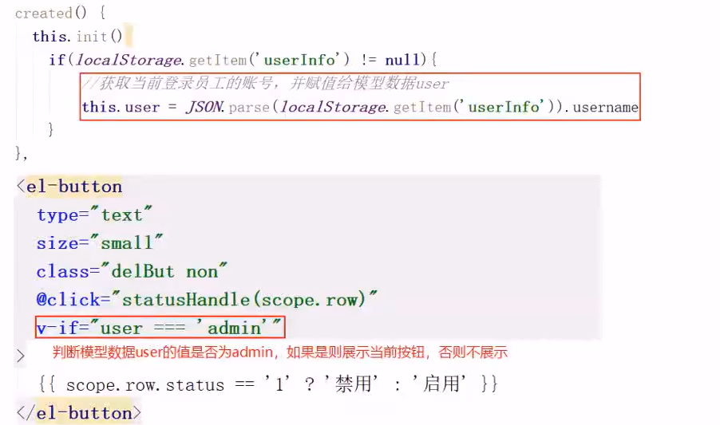

在开发代码之前，需要梳理一下整个程序的执行过程：
1、页面发送ajax请求，将参数(id、status)提交到服务端
2、服务端Controller接收页面提交的数据并调用Service更新数据
3、Service调用Mapper操作数据库

启用、禁用员工账号，本质上就是一个更新操作，也就是对status状态字段进行操作在Controller中创建update方法，此方法是一个通用的修改员工信息的方法

**功能测试**
测试过程中没有报错,但是功能并没有实现,查看数据库中的数据也没有变化。
观察控制台输出的SQL: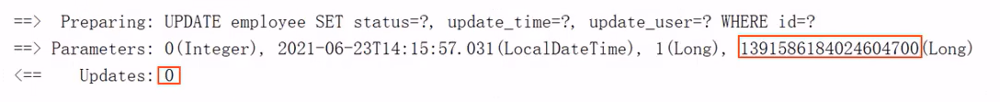

SQL执行的结果是更新的数据行数为0，仔细观察id的值，和数据库中对应记录的id值并不相同

**代码修复**
通过观察控制台输出的SQL发现页面传递过来的员工id的值和数据库中的id值不一致，这是怎么回事呢？分页查询时服务端响应给页面的数据中id的值为19位数字，类型为long

页面中js处理long型数字只能精确到前16位，所以最终通过ajax请求提交给服务端的时候id变为了139158184024604700

**如何解决这个问题？**
我们可以在服务端给页面响应json数据时进行处理，将long型数据统一转为String字符串

**具体实现步骤：**
1) 提供对象转换器jacksonObjectMapper,基于Jackson进行java对象到json数据的转换（资料中已经提供，直接复制到项目中使用）
2) 在WebMvcConfig配置类中扩展Spring mvc的消息转换器，在此消息转换器中使用提供的对象转换器进行java对象到json数据的转换


### 编辑员工信息

**需求分析**
在员工管理列表页面点击编辑按钮，跳转到编辑页面，在编辑页面回显员工信息并进行修改，最后点击保存按钮完成编辑操作

**代码开发**
在开发代码之前需要梳理一下操作过程和对应的程序的执行流程：
1、点击编辑按钮时，页面跳转到add.html,并在url中携带参数[员工id]
2、在add.html页面获取url中的参数[员工id]
3、发送ajax请求，请求服务端，同时提交员工id参数
4、服务端接收请求，根据员工id查询员工信息，将员工信息以json形式响应给页面
5、页面接收服务端响应的json数据，通过VUE的数据绑定进行员工信息回显
6、点击保存按钮，发送ajax请求，将页面中的员工信息以json方式提交给服务端
7、服务端接收员工信息，并进行处理，完成后给页面响应
8、页面接收到服务端响应信息后进行相应处理

**注意：add.html页面为公共页面，新增员工和编辑员工都是在此页面操作**


## 分类管理业务开发

### 公共字段自动填充

**问题分析**
前面我们已经完成了后台系统的员工管理功能开发，在新增员工时需要设置创建时间、创建人、修改时间、修改人等字段，在编辑员工时需要设置修改时间和修改人等字段。这些字段属于公共字段，也就是很多表中都有这些字段，如下：

能不能对于这些公共字段在某个地方统一处理，来简化开发呢？
答案就是使用Mybatis Plus提供的**公共字段自动填充**功能。

**代码实现**
Mybatis Plus公共字段自动填充，也就是在插入或者更新的时候为指定字段赋予指定的值，使用它的好处就是可以统一对这些字段进行处理，避免了重复代码。

实现步骤：
1、在实体类的属性上加入@TableField注解，指定自动填充的策略
2、按照框架要求编写元数据对象处理器，在此类中统一为公共字段赋值，此类需要实现MetaObjectHandler接口

注意：当前我们设置createUser和updateUser为固定值，后面我们需要进行改造，改为动态获得当前登录用户的id

**功能测试**
将EmployeeController中的新增和修改方法中手动设置公共字段的代码注释掉，测试这些公共字段是否完成了自动填充。
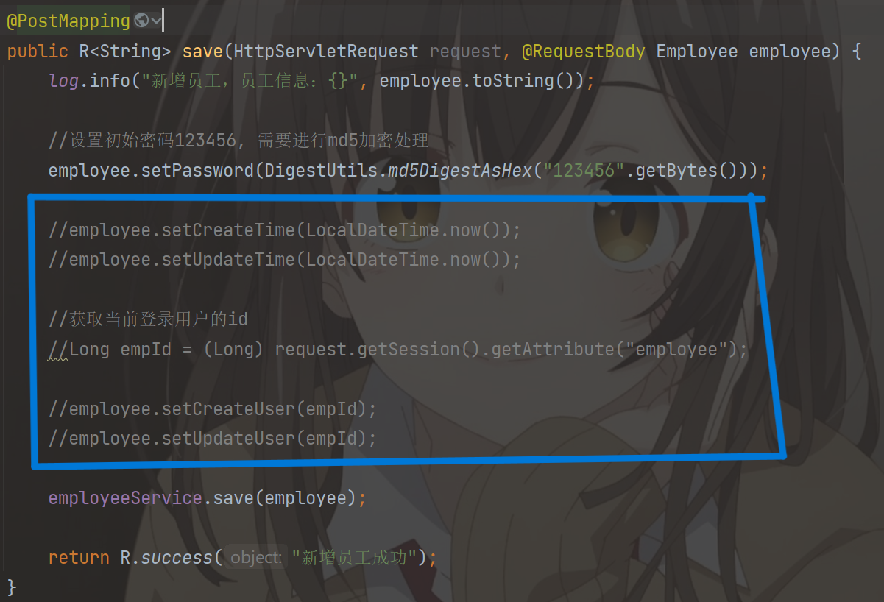

**功能完善**
前面我们已经完成了公共字段自动填充功能的代码开发，但是还有一个问题没有解决，就是我们在自动填充createUser和updateUser时设置的用户id是固定值，现在我们需要改造成动态获取当前登录用户的id。
有的同学可能想到，用户登录成功后我们将用户id存入了HttpSession中，现在我从HttpSession中获取不就行了？
注意，我们在MyMetaObjectHandler类中是不能获得HttpSession对象的，所以我们需要通过其他方式来获取登录用户id。
可以使用ThreadLocal来解决此问题，它是JDK中提供的一个类。

在学习ThreadLocal之前,我们需要先确认一个事情,就是客户端发送的每次http请求,对应的在服务端都会分配一个新的线程来处理,在处理过程中涉及到下面类中的方法都属于相同的一个线程:
1、LoginCheckFilter的doFilter方法
2、EmployeeController的update方法
3、MyMetaObjectHandler的updatefill方法
可以在上面的三个方法中分别加入下面代码(获取当前线程id) :

```java
long id = Thread.currentThread().getId();
log.info("线程id为：{}", id);
```

执行编辑员工功能进行验证，通过观察控制台输出可以发现，一次请求对应的线程id是相同的：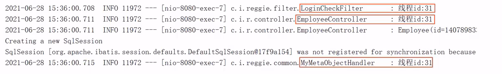

**什么是ThreadLocal?**
ThreadLocal并不是一个Thread,而是Thread的局部变量。当使用ThreadLocal维护变量时，ThreadLocal为每个使用该变量的线程提供独立的变量副本，所以每一个线程都可以独立地改变自己的副本，而不会影响其它线程所对应的副本。
ThreadLocal为每个线程提供单独一份存储空间，具有线程隔离的效果，只有在线程内才能获取到对应的值，线程外则不能访问

**ThreadLocal常用方法：**
public void set(T value)	设置当前线程的线程局部变量的值
public T get()	返回当前线程所对应的线程局部变量的值

我们可以在LoginCheckFilter的doFilter方法中获取当前登录用户id,并调用ThreadLocal的set方法来设置当前线程的线程局部变量的值(用户id),然后在MyMetaObjectHandler的updateFill方法中调用ThreadLocal的get方法来获得当前线程所对应的线程局部变量的值(用户id)。

**实现步骤**
1、编写BaseContext工具类，基于ThreadLocal封装的工具类
2、在LoginCheckFilter的doFilter方法中调用BaseContext来设置当前登录用户的id
3、在MyMetaObjectHandlert的方法中调用BaseContext获取登录用户的id


### 新增分类

**需求分析**
后台系统中可以管理分类信息，分类包括两种类型，分别是菜品分类和套餐分类。当我们在后台系统中添加菜品时需要选择一个菜品分类，当我们在后台系统中添加一个套餐时需要选择一个套餐分类，在移动端也会按照菜品分类和套餐分类来展示对应的菜品和套餐。

**数据模型**
新增分类,其实就是将我们新增窗口录入的分类数据插入到category表
需要注意，category表中对name字段加入了唯一约束，保证分类的名称是唯一的

**代码开发**
在开发业务功能前，先将需要用到的类和接口基本结构创建好：
< 实体类Category
< Mapper接口CategoryMapper
< 业务层接口CategoryService
< 业务层实现类CategoryServiceImpl
< 控制层CategoryController

在开发代码之前，需要梳理一下整个程序的执行过程：
1、页面(backend/page/category/list.html)发送ajax请求,将新增分类窗口输入的数据以json形式提交到服务端
2、服务端Controller接收页面提交的数据并调用Service将数据进行保存
3、Service调用Mapper操作数据库,保存数据

可以看到新增菜品分类和新增套餐分类请求的服务端地址和提交的json数据结构相同,所以服务端只需要提供一个方法统一处理即可。


### 分类信息分页查询

**需求分析**
系统中的分类很多的时候，如果在一个页面中全部展示出来会显得比较乱，不便于查看，所以一般的系统中都会以分页的方式来展示列表数据。

**代码开发**
在开发代码之前，需要梳理一下整个程序的执行过程：
1、页面发送ajax请求,将分页查询参数(page、pageSize)提交到服务端
2、服务端Controller接收页面提交的数据并调用Service查询数据
3、Service调用Mapper操作数据库，查询分页数据
4、Controller将查询到的分页数据响应给页面
5、页面接收到分页数据并通过ElementUl的Table组件展示到页面上


### 删除分类

**需求分析**
在分类管理列表页面，可以对某个分类进行删除操作。需要注意的是当分类关联了菜品或者套餐时，此分类不允许删除。

**代码开发**
在开发代码之前，需要梳理一下整个程序的执行过程：
1、页面发送ajax请求，将参数(id)提交到服务端
2、服务端Controller接收页面提交的数据并调用Service删除数据
3、Service调用Mapper操作数据库

**功能完善**
前面我们已经实现了根据id删除分类的功能,但是并没有检查删除的分类是否关联了菜品或者套餐,所以我们需要进行功能完善。

要完善分类删除功能，需要先准备基础的类和接口：
1、实体类Dish和Setmeal
2、Mapper接口DishMapper和SetmealMapper
3、Service接口DishService和SetmealService
4、Service实现类DishServicelmpl和SetmealServicelmpl


### 修改分类

**需求分析**
在分类管理列表页面点击修改按钮，弹出修改窗口，在修改窗口回显分类信息并进行修改，最后点击确定按钮完成修改操作


## 菜品管理业务开发

### 文件上传下载

**文件上传介绍**
文件上传，也称为 upload，是指将本地图片、视频、音频等文件上传到服务器上，可以供其他用户浏览或下载的过程。
文件上传在项目中应用非常广泛，我们经常发微博、发微信朋友圈都用到了文件上传功能。

文件上传时，对页面的 form 表单有如下要求:
method="post"							采用 post 方式提交数据
enctype="multipart/form-data"	采用 multipart 格式上传文件
type="file"									使用 input 的 file 控件上传

举例

```html
<form method="post" action="/common/upload" enctype="multipart/form-data">
    <input name="myFile" type="file" />
    <input type="submit" value="提交"/>
</form>
```

目前一些前端组件库也提供了相应的上传组件，但是底层原理还是基于form表单的文件上传。
例如 ElementUl 中提供的upload上传组件:

服务端要接收客户端页面上传的文件,通常都会使用 Apache 的两个组件:
commons-fileupload
commons-io

Spring 框架在 spring-web 包中对文件上传进行了封装，大大简化了服务端代码，我们只需要在 Controller 的方法中声明一个 MultipartFile 类型的参数即可接收上传的文件，例如:


**文件下载介绍**
文件下载，也称为 download，是指将文件从服务器传输到本地计算机的过程。

通过浏览器进行文件下载，通常有两种表现形式：
》以附件形式下载，弹出保存对话框，将文件保存到指定磁盘目录
》直接在浏览器中打开

通过浏览器进行文件下载，本质上就是服务端将文件以流的形式写回浏览器的过程。

**文件上传代码实现**
文件上传，页面端可以使用 ElementUI 提供的上传组件。
可以直接使用资料中提供的上传页面，位置:资料/文件上传下载页面/upload. html

**文件下载代码实现**
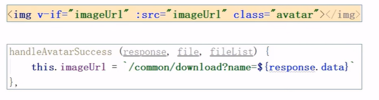


### 新增菜品

**需求分析**
后台系统中可以管理菜品信息，通过新增功能来添加一个新的菜品，在添加菜品时需要选择当前菜品所属的菜品分类，并且需要上传菜品图片，在移动端会按照菜品分类来展示对应的菜品信息。

**数据模型**
新增菜品，其实就是将新增页面录入的菜品信息插入到 dish 表，如果添加了口味做法，还需要向 dish_flavor 表插入数据。

所以在新增菜品时，涉及到两个表:
dish	菜品表
dish_flavor	菜品口味表

**代码开发-准备工作**
在开发业务功能前，先将需要用到的类和接口基本结构创建好：
实体类 DishFlavor
Mapper 接口 DishFlavorMapper
业务层接口 DishFlavorService
业务层实现类 DishFlavorServiceImpl
控制层 DishController

**代码开发-梳理交互过程**
在开发代码之前，需要梳理一下新增菜品时前端页面和服务端的交互过程：
1、页面（backend／page／food／add.html）发送 ajax 请求，请求服务端获取菜品分类数据并展示到下拉框中
2、页面发送请求进行图片上传，请求服务端将图片保存到服务器
3、页面发送请求进行图片下载，将上传的图片进行回显
4、点击保存按钮，发送 ajax 请求，将菜品相关数据以 json 形式提交到服务端

开发新增菜品功能，其实就是在服务端编写代码去处理前端页面发送的这 4 次请求即可。

**代码开发-导入DTO**
导入 DishDto (位置：资料/dto)，用于封装页面提交的数据

注意事项：DTO，全称为 Data Transfer Object，即数据传输对象，一般用于展示层与服务层之间的数据传输。


### 菜品信息分页查询

**需求分析**
系统中的菜品数据很多的时候,如果在一个页面中全部展示出来会显得比较乱,不便于查看，所以一般的系统中都会以分页的方式来展示列表数据。

**代码开发-梳理交互过程**
在开发代码之前，需要梳理一下菜品分页查询时前端页面和服务端的交互过程：
1、页面 (backend/page/food/ist. html) 发送 ajax 请求，将分页查询参数 (page、pageSize、name) 提交到服务端，获取分页数据
2、页面发送请求，请求服务端进行图片下载，用于页面图片展示

开发菜品信息分页查询功能，其实就是在服务端编写代码去处理前端页面发送的这2次请求即可。


### 修改菜品

**需求分析**
在菜品管理列表页面点击修改按钮，跳转到修改菜品页面，在修改页面回显菜品相关信息并进行修改，最后点击确定按钮完成修改操作

**代码开发-梳理交互过程**
在开发代码之前,需要梳理一下修改菜品时前端页面 (add. html) 和服务端的交互过程:
1、页面发送 ajax 请求,请求服务端获取分类数据,用于菜品分类下拉框中数据展示
2、页面发送 ajax 请求,请求服务端,根据 id 查询当前菜品信息,用于菜品信息回显
3、页面发送请求,请求服务端进行图片下载,用于页图片回显
4、点击保存按钮,页面发送 ajax 请求,将修改后的菜品相关数据以 json 形式提交到服务端

开发修改菜品功能,其实就是在服务端编写代码去处理前端页面发送的这 4 次请求即可。


## 套餐管理业务开发

### 新增套餐

**需求分析**
套餐就是菜品的集合。
后台系统中可以管理套餐信息,通过新增套餐功能来添加一个新的套餐,在添加套餐时需要选择当前套餐所属的套餐分类和包含的菜品,并且需要上传套餐对应的图片,在移动端会按照套餐分类来展示对应的套餐。

**数据模型**
新增套餐，其实就是将新增页面录入的套餐信息插入到 setmeal 表，还需要向 setmeal＿dish 表插入套餐和菜品关联数据。
所以在新增套餐时，涉及到两个表：
setmeal 套餐表
setmeal_dish 套餐菜品关系表

**代码开发-准备工作**
在开发业务功能前，先将需要用到的类和接口基本结构创建好:
实体类 SetmealDish 
DTO SetmealDto
Mapper 接口 SetmealDishMapper 
业务层接口 SetmealDishService 
业务层实现类 SetmealDishServicelmpl 
控制层 SetmealController

**代码开发-梳理交互过程**
在开发代码之前，需要梳理一下新增套餐时前端页面和服务端的交互过程：
1、页面（backend／page／combo／add．html）发送 ajax 请求，请求服务端获取套餐分类数据并展示到下拉框中
2、页面发送 ajax 请求，请求服务端获取菜品分类数据并展示到添加菜品窗口中
3、页面发送 ajax 请求，请求服务端，根据菜品分类查询对应的菜品数据并展示到添加菜品窗口中
4、页面发送请求进行图片上传，请求服务端将图片保存到服务器
5、页面发送请求进行图片下载，将上传的图片进行回显
6、点击保存按钮，发送 ajax 请求，将套餐相关数据以 json 形式提交到服务端

开发新增套餐功能，其实就是在服务端编写代码去处理前端页面发送的这 6 次请求即可。


### 套餐信息分页查询

**需求分析**
系统中的套餐数据很多的时候，如果在一个页面中全部展示出来会显得比较乱，不便于查看，所以一般的系统中都会以分页的方式来展示列表数据。

**代码开发-梳理交互过程**
在开发代码之前，需要梳理一下套餐分页查询时前端页面和服务端的交互过程：
1、页面 (backend/page/combo/list. html) 发送 ajax 请求， 将分页查询参数 (page、pageSize、name) 提交到服务端， 获取分页数据
2、页面发送请求，请求服务端进行图片下载，用于页面图片展示

开发套餐信息分页查询功能，其实就是在服务端编写代码去处理前端页面发送的这 2 次请求即可。


### 删除套餐

**需求分析**
在套餐管理列表页面点击删除按钮，可以删除对应的套餐信息。也可以通过复选框选择多个套餐，点击批量删除按钮一次删除多个套餐。注意，对于状态为售卖中的套餐不能删除，需要先停售，然后才能删除。

**代码开发-梳理交互过程**
在开发代码之前，需要梳理一下删除套餐时前端页面和服务端的交互过程：
1、删除单个套餐时，页面发送 ajax 请求，根据套餐 id 删除对应套餐
2、删除多个套餐时，页面发送 ajax 请求,根据提交的多个套餐 id 删除对应套餐

开发删除套餐功能，其实就是在服务端编写代码去处理前端页面发送的这 2 次请求即可。
观察删除单个套餐和批量删除套餐的请求信息可以发现，两种请求的地址和请求方式都是相同的，不同的则是传递的 id 个数，所以在服务端可以提供一个方法来统一处理。


## 手机验证码登录

### 短信发送

**短信服务介绍**
目前市面上有很多第三方提供的短信服务,这些第三方短信服务会和各个运营商 (移动、联通、电信) 对接,我们只需要注册成为会员并且按照提供的开发文档进行调用就可以发送短信。需要说明的是,这些短信服务一般都是收费服务。

常用短信服务：

- 阿里云
- 华为云
- 腾讯云
- 京东
- 梦网
- 乐信

**阿里云短信服务-介绍**
阿里云短信服务 (Short Message Service) 是广大企业客户快速触达手机用户所优选使用的通信能力。调用 API 或用群发助手,即可发送验证码、通知类和营销类短信;国内验证短信秒级触达,到达率最高可达 99%;国际/港澳台短信覆盖200 多个国家和地区,安全稳定,广受出海企业选用。

应用场景：
《 验证码
《 短信通知
《 推广短信

**阿里云短信服务-设置AccessKey**
光标移动到用户头像上，在弹出的窗口中点击【AccessKey 管理】：

**代码开发**
使用阿里云短信服务发送短信，可以参照官方提供的文档即可。

具体开发步骤：
1、导入 maven 坐标
2、调用 API


### 手机验证码登录

**需求分析**
为了方便用户登录，移动端通常都会提供通过手机验证码登录的功能。

手机验证码登录的优点：
方便快捷，无需注册，直接登录
使用短信验证码作为登录凭证，无需记忆密码安全

登录流程：
输入手机号>获取验证码>输入验证码>点击登录>登录成功

注意：通过手机验证码登录，手机号是区分不同用户的标识。

**数据模型**
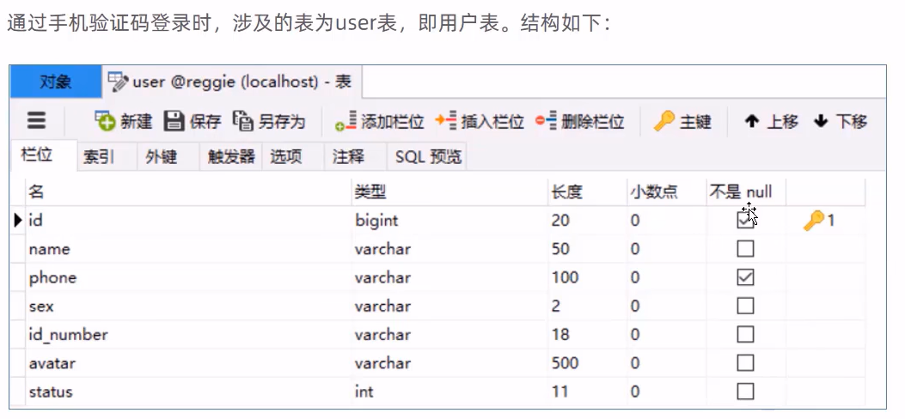

**代码开发-梳理交互过程**
在开发代码之前,需要梳理一下登录时前端页面和服务端的交互过程:
1、在登录页面 (front/page/login. html) 输入手机号,点击【获取验证码】按钮,页面发送 ajax 请求,在服务端调用短信服务 API 给指定手机号发送验证码短信
2、在登录页面输入验证码,点击【登录】按钮,发送 ajax 请求,在服务端处理登录请求

开发手机验证码登录功能,其实就是在服务端编写代码去处理前端页面发送的这 2 次请求即可。

**代码开发-准备工作**
在开发业务功能前，先将需要用到的类和接口基本结构创建好:

- 实体类 User (直接从课程资料中导入即可) 
- Mapper 接口 UserMapper 
- 业务层接口 UserService 
- 业务层实现类 UserServicelmpl 
- 控制层 UserController
- 工具类 SMSUtils、ValidateCodeUtils（直接从课程资料中导入即可）

**代码开发-修改LoginCheckFilter**
前面我们已经完成了 LoginCheckFilter 过滤器的开发，此过滤器用于检查用户的登录状态。我们在进行手机验证码登录时，发送的请求需要在此过滤器处理时直接放行。
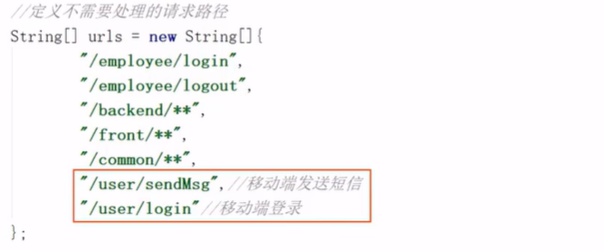

**代码开发-修改LoginCheckFilter**
在 LoginCheckFilter 过滤器中扩展逻辑，判断移动端用户登录状态:


## 菜品展示、购物车、下单

### 导入用户地址簿相关功能代码

**需求分析**
地址簿，指的是移动端消费者用户的地址信息，用户登录成功后可以维护自己的地址信息。同一个用户可以有多个地址信息，但是只能有一个默认地址。

**数据模型**
用户的地址信息会存储在 address_book 表，即地址簿表中。

**导入功能代码**
功能代码清单：
实体类 AddressBook
Mapper 接口 AddressBookMapper 
业务层接口 AddressBookService 
业务层实现类 AddressBookServicelmpl
控制层 AddressBookController


### 菜品展示

**需求分析**


**代码开发-梳理交互过程**
在开发代码之前，需要梳理一下前端页面和服务端的交互过程：
1、页面 (front/index. html) 发送 ajax 请求， 获取分类数据 (菜品分类和套餐分类)
2、页面发送 ajax 请求， 获取第一个分类下的菜品或者套餐
开发菜品展示功能，其实就是在服务端编写代码去处理前端页面发送的这 2 次请求即可。

注意：首页加载完成后， 还发送了一次 ajax 请求用于加载购物车数据， 此处可以将这次请求的地址暂时修改一下， 从静态 json 文件获取数据， 等后续开发购物车功能时再修改回来。


### 购物车

**需求分析**


**数据模型**
购物车对应的数据表为 shopping_cart 表

**代码开发-梳理交互过程**


**代码开发-准备工作**
在开发业务功能前，先将需要用到的类和接口基本结构创建好：
实体类 ShoppingCart 
Mapper 接口 ShoppingCartMapper 
业务层接口 ShoppingCartService 
业务层实现类 ShoppingCartServicelmpl 
控制层 ShoppingCartController


### 用户下单

**需求分析**
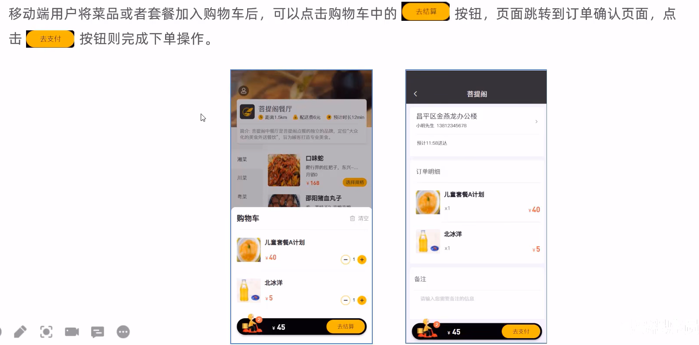

**数据模型**
用户下单业务对应的数据表为 orders 表和 order_detail 表：
orders：订单表
order_detail：订单明细表

**代码开发-梳理交互过程**


**代码开发-准备工作**
在开发业务功能前，先将需要用到的类和接口基本结构创建好:
实体类 Orders、OrderDetail (直接从课程资料中导入即可) 
Mapper 接口 OrderMapper、OrderDetailMapper 
业务层接口 OrderService、OrderDetailService 
业务层实现类 OrderServicelmpl、 OrderDetailServicelmpl 
控制层 OrderController, OrderDetailController


